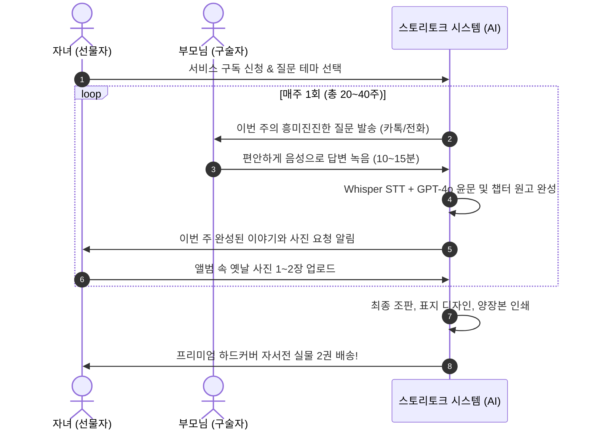

# [기획서] 무노력(Zero-Effort) 대화형 구술 자서전: "스토리토크 (StoryTalk)"

> **"부모님은 타자 칠 필요가 없습니다. 그저 수다만 떠세요, 책은 AI가 씁니다."**  
> 글로벌 1위 자서전 서비스(Storyworth)의 최대 약점인 '글쓰기 부담'을 완벽히 해결한 **음성 구술 기반 100% 자동 출판 플랫폼**

---

## 1. 기획 배경 및 시장 기회 (Storyworth의 치명적 한계)

### 1.1 Storyworth의 성공과 실패
- **성공 요인**: 미국에서 수백만 부모에게 선물된 'Storyworth'는 매주 이메일로 질문을 하나씩 보내주고, 1년 뒤 이를 모아 책으로 만들어주는 아이디어로 연 수백억 원의 매출을 올렸습니다.
- **치명적 실패 (80% 중도 포기율)**:
  - 노안과 타자 미숙으로 인해 **글을 쓰거나 타자를 칠 수 있는 부모님은 극소수**에 불과합니다.
  - 레딧 커뮤니티의 수많은 후기: *"선물해 드렸는데 3주 만에 부모님이 '숙제 같다'며 부담스러워하셔서 돈만 날렸다."*

### 1.2 "스토리토크"의 파괴적 혁신: Zero-Effort (노력 제로)
- **부모님의 행동**: 일주일에 한 번, 전화를 받거나 카톡 링크에서 마이크 버튼을 누르고 **그냥 말(음성)로 10분 동안 편하게 떠들기만 하면 끝**.
- **AI의 행동**: 어르신의 거친 구술체와 사투리를 자연스럽고 감동적인 **'문학적 에세이/자서전 문체'**로 100% 자동 편집.

---

## 2. 서비스 운영 프로세스

---

## 3. 핵심 차별화 기술 및 UX

1. **'숙제'가 아닌 '즐거운 수다' 유도 질문**:
   - 딱딱한 질문(*"학창 시절을 서술하시오"*)이 아닌, 감정을 끄집어내는 질문:
     - *"엄마, 아빠랑 연애할 때 첫 데이트에서 무슨 음식 먹었어?"*
     - *"내 어릴 적 사고 쳐서 엄마를 제일 울렸던 일이 뭐야?"*
2. **구술체 → 자서전 문체 변환 프롬프트 엔진**:
   - 어르신의 고유한 개성과 말맛은 보존하면서도, 맞춤법과 문맥을 유려하게 다듬어 전문 작가가 대필한 것 같은 품격 있는 문장으로 변환.
3. **가족 공동 참여 (자녀는 사진 업로드 담당)**:
   - 부모님이 이야기를 녹음하면 자녀에게 카톡이 가서, *"오늘 어머님이 첫 자취방 이야기를 하셨어요. 관련 사진이 있다면 올려주세요"*라며 자연스러운 가족 협업 유도.

---

## 4. 상품 라인업 및 가격 모델 (Pricing)

| 구분 | 10주 단기 완성 (미니 자서전) | **1년 완주 (정규 자서전) - [대표]** |
| :--- | :---: | :---: |
| **인터뷰 분량** | 주 1회 × 10회 (총 10개 챕터) | **주 1회 × 30회 (총 30개 챕터)** |
| **책 사양** | 소프트커버 60페이지 (1권) | **고급 하드커버 양장본 150페이지 (2권)** |
| **사진 수록** | 사진 20장 내외 수록 | 사진 60장 내외 수록 + 보정 |
| **추가 혜택** | 모바일 전자책(ePub) 제공 | 모바일 전자책 + 오디오 음성 파일 수록 |
| **판매 가격** | **129,000원** | **249,000원** (추가 인쇄 권당 35,000원) |

---

## 5. 비즈니스 확장성
- **미국/일본 글로벌 진출 용이**: Storyworth가 장악한 영미권 시장 및 초고령 사회인 일본 시장에 "음성 기반 Zero-Effort"를 내세워 글로벌 SaaS로 즉각 확장 가능.
