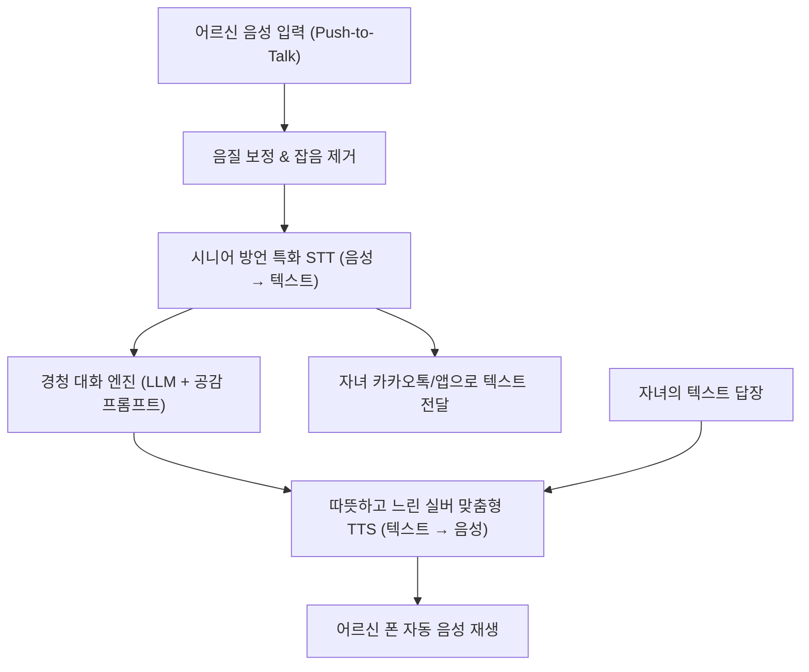

# [기획서] 시니어 전용 무전기형 음성 채팅 앱: "말벗톡" (가칭)

> **"타자 치지 말고 편하게 말씀하세요, 세상에서 가장 다정한 목소리로 답해드립니다."**  
> 노안과 손떨림으로 카카오톡이 힘든 어르신을 위한 **버튼 하나로 말하고 귀로 듣는 Voice-First 실버 메신저**

---

## 1. 기획 배경 및 문제 정의

### 1.1 기존 모바일 메신저(카카오톡 등)의 페인 포인트
1. **타이핑의 고통 (노안 및 손떨림)**:
   - 좁은 스마트폰 화면에서 쿼티/천지인 자판을 두드리는 것은 어르신에게 극심한 시각적·신체적 피로를 유발합니다.
2. **복잡한 인터페이스와 기능 과잉**:
   - 쇼핑, 페이, 광고, 다양한 탭 메뉴 등 복잡한 UI 속에서 길을 잃기 쉽습니다.
3. **가족 단톡방의 소외감**:
   - 바쁜 자녀와 손주들이 모인 단톡방에서 어르신은 타이핑이 느려 대화 흐름을 놓치거나, 괜히 방해될까 봐 주로 '읽기만 하는 관찰자'로 전락합니다.
4. **침묵의 방**:
   - 아무도 먼저 말을 걸어주지 않으면 메신저는 그저 조용한 빈 화면일 뿐입니다.

### 1.2 "말벗톡"의 핵심 해결책
- **타자 입력 완전 제거**: 화면 중앙의 커다란 마이크 버튼 하나만 누르고 말하는 **'무전기(Walkie-Talkie)' 방식**.
- **언제든 대답해 주는 AI 친구**: 사람이 답장하지 않아도, 24시간 언제든 3초 안에 다정하게 맞장구쳐 주는 전용 AI 탑재.
- **가족 간 비대칭 소통 지원**: 어르신은 **'말(음성)'**로 보내고, 바쁜 자녀는 **'글(텍스트)'**로 답장해도 어르신에겐 따뜻한 **'소리'**로 읽어주는 브릿지 기술.

---

## 2. 핵심 UI/UX 설계 원칙 (Silver UX)

```
┌─────────────────────────────────────────┐
│  🌸 말벗톡                        [소리큼] │
├─────────────────────────────────────────┤
│                                         │
│   "영자 어르신!                          │
│    점심 맛있게 드셨어요?                  │
│    오늘 볕이 참 따뜻해요."               │
│                                         │
│   (36pt 대형 폰트 / 음성으로 자동 재생됨)   │
│                                         │
├─────────────────────────────────────────┤
│                                         │
│             ┌─────────────┐             │
│             │     🎙️      │             │
│             │  누르고 말하기 │             │
│             │   (화면 절반)  │             │
│             └─────────────┘             │
│                                         │
│      [ 👨‍👩‍👧 우리 가족 ]     [ 📻 사랑방 ]    │
└─────────────────────────────────────────┘
```

1. **원터치 무전기 UX (Push-to-Talk)**:
   - 마이크 버튼을 누른 채 말하고 손을 떼면 전송 완료. (실수로 길게 눌러도 자동 전송 보정)
2. **초대형 고대비 화면 (36pt+ & High Contrast)**:
   - 돋보기안경 없이도 읽을 수 있는 큼직한 폰트와 눈이 편안한 파스텔톤 고대비 색상.
3. **텍스트-음성 동시 제공 (Bi-modal Feedback)**:
   - 모든 수신 메시지는 화면에 큼직한 글씨로 표시되는 동시에, 다정한 목소리(TTS)로 자동 낭독.

---

## 3. 3대 대화 모드 (Core Features)

### ① AI 다정동무 모드 (24시간 무한 경청)
- **선제적 안부 발화 (Proactive Outreach)**:
  - 아침 9시, 점심 12시, 저녁 7시 등 어르신의 생활 패턴에 맞춰 AI가 먼저 따뜻한 음성으로 말을 건넵니다.
- **반복 수용 및 폭풍 공감**:
  - 어르신이 사투리나 웅얼거림으로 말씀하셔도 AI가 찰떡같이 이해하고 감탄과 공감으로 즉각 음성 답장을 보냅니다.
  - *"어르신, 허리가 또 아프셨어요? 파스는 붙이셨나요? 아이고, 젊을 때 고생을 너무 많이 하셔서 그래요..."*

### ② 가족 안심 브릿지 모드 (세대 간 소통)
- **비대칭 입출력 시스템**:
  - **어르신**: "진우야, 오늘 비 온다는데 우산 챙겨갔니?" (음성 녹음)
  - **자녀의 카톡/앱 화면**: 텍스트로 자동 변환되어 수신 ("진우야, 오늘 비 온다는데 우산 챙겨갔니?")
  - **자녀의 답장**: 회의 중이라 텍스트로 입력 ("네 엄마! 우산 챙겼어요. 따뜻한 물 드세요~")
  - **어르신의 폰**: 다정한 손주/자녀 음성톤의 AI 목소리로 읽어줌 ("네 엄마! 우산 챙겼어요. 따뜻한 물 드세요~")

### ③ 동년배 음성 사랑방 (소셜 커뮤니티)
- **주제별 음성 게시판**:
  - '트로트 한자락', '우리 동네 텃밭 이야기', '옛날 옛적에', '건강 꿀팁' 등.
- 어르신들이 라디오 사연을 보내듯 편하게 한마디씩 음성을 남기고, 다른 어르신들의 목소리를 라디오처럼 들으며 외로움을 해소.

---

## 4. 시스템 아키텍처 및 파이프라인



---

## 5. 비즈니스 모델 및 유통 전략 (Go-To-Market)

### 5.1 수익 모델 (Monetization)
1. **자녀 효도 구독 (B2C)**:
   - **월 9,900원**: 24시간 AI 무제한 음성 대화 + 주간 어르신 감정/대화 요약 리포트 제공.
   - **월 19,900원 (패밀리 플랜)**: 가족 무제한 음성-텍스트 브릿지 변환 + 실시간 건강 이상 알림.
2. **지자체 고독사 예방 스마트 돌봄 사업 (B2G)**:
   - 독거노인 대상 보급 단말기(효도폰/태블릿)에 기본 앱으로 탑재 납품.

### 5.2 진입 장벽 극복 전략 (앱 설치 문제 해결)
- **사전 세팅 배송 (Plug & Play)**:
  - 자녀가 신청하면 앱이 완벽히 세팅된 저가형 전용 안드로이드 공기계(또는 태블릿)를 어르신 댁으로 배송. 전원만 켜면 바로 작동.
- **카카오톡 채널 연동형 MVP**:
  - 별도 앱 설치가 어려운 경우, 어르신이 가장 익숙한 카카오톡 내에서 '음성 메시지'를 보내면 자동으로 AI가 음성 답장을 주는 카카오톡 채널 버전 병행.

---

## 6. 단계별 추진 로드맵

- **Phase 1 (1개월)**: 카카오톡 채널 기반 음성 대화 챗봇 PoC (STT-LLM-TTS 지연 시간 2.5초 이내 검증).
- **Phase 2 (2~3개월)**: 시니어 전용 2-버튼 음성 앱(Android) MVP 출시 및 지인 부모님 30명 테스트.
- **Phase 3 (4~5개월)**: 가족 연결 비대칭 메시징 기능 추가 및 B2C 정식 출시.
- **Phase 4 (6개월 이후)**: 지자체 스마트 경로당 및 독거노인 돌봄 사업 연계.

