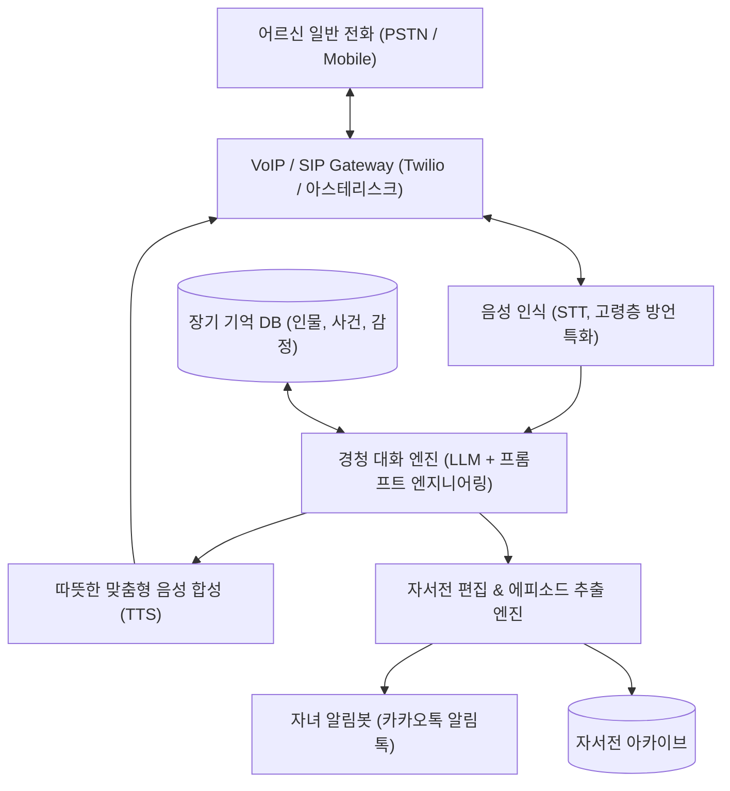

# [기획서] 어르신 이야기 경청 및 인생 기록 서비스: "이야기꽃" (가칭)

> **"세상에서 가장 다정하게 귀 기울여 듣는 어르신 전용 이야기 친구"**  
> 단순한 안부 확인이나 감시가 아닌, **어르신의 지나온 삶과 일상을 진심으로 경청하고 인정(Validation)하는 공감형 AI 서비스**

---

## 1. 기획 배경 및 문제 정의 (Background & Problem)

### 1.1 현상과 문제의식
- **말할 곳이 없는 어르신들**:
  많은 어르신들이 "아무도 내 말을 들어주지 않는다"는 깊은 외로움과 서운함을 느낍니다.
- **기존 노인 돌봄 서비스의 맹점 (관리·통제 중심)**:
  - 현재 보급된 대부분의 AI 돌봄/안부 전화는 *"약 드셨어요?", "식사하셨어요?", "추우니 외출하지 마세요"* 위주의 **'생존 확인 및 감시형 인터랙션'**입니다.
  - 어르신 입장에서는 보호받는 느낌도 있지만, 피동적인 수혜자가 되어 오히려 "내가 짐이 되었구나"라는 무력감을 느끼기 쉽습니다.
- **가족(자녀)의 현실적 딜레마**:
  - 30~50대 자녀들은 부모님께 효도하고 싶고 외로움을 덜어드리고 싶지만, 바쁜 일상과 생업으로 인해 매일 20~30분씩 부모님의 반복되는 옛이야기나 하소연을 경청해 드릴 물리적·정서적 여유가 없습니다.
  - 이로 인해 자녀는 늘 **마음의 죄책감(Guilt)**을 안고 살아갑니다.

### 1.2 심리학적·의학적 가치 (왜 '경청'인가?)
1. **에릭슨(Erikson)의 노년기 발달과업: 자아통합감(Ego Integrity)**
   - 인간은 노년기에 이르러 자신의 지나온 삶을 회고하고, 그 삶이 가치 있었음을 인정받음으로써 죽음에 대한 공포를 극복하고 심리적 안정을 찾습니다.
2. **회상 요법(Reminiscence Therapy)의 효과**
   - 과거의 경험, 고난 극복기, 자랑거리 등을 이야기하는 과정은 뇌의 기억 중추를 강하게 자극하여 **우울증 완화 및 치매(인지 저하) 예방**에 탁월한 효과가 있음이 임상적으로 입증되어 있습니다.
3. **'화자(주인공)'로서의 자존감 회복**
   - 질문에 단답형으로 대답하는 피보호자가 아니라, 자신의 인생 경험과 지혜를 들려주는 **'이야기의 주인공'이자 '선생님'**의 위치를 되찾아 드립니다.

---

## 2. 서비스 핵심 컨셉 (Core Concept)

| 구분 | 기존 AI 안부 서비스 | 이야기꽃 (본 서비스) |
| :--- | :--- | :--- |
| **목적** | 고독사 예방, 복약/식사 안전 확인 | **외로움 해소, 정서적 충족, 자존감 회복** |
| **대화 톤** | 사무적, 확인형, 단답 유도 | **다정함, 감탄, 폭풍 맞장구, 심층 경청** |
| **역할 관계** | 관리자(AI) ↔ 관리 대상(노인) | **호기심 많은 친구/손주(AI) ↔ 인생 선배(노인)** |
| **핵심 결과물** | 안전 여부 로그 | **정서적 안정감 + 어르신 구술 자서전(인생 기록)** |

---

## 3. 핵심 기능 (Key Features)

### ① AI 전용 경청 전화 (앱 설치 없는 Inbound/Outbound Call)
- **Zero-Barrier 접근성**: 스마트폰 조작이 어려운 어르신을 위해 앱 설치 없이 일반 전화(02/070 발신 및 수신)로 작동합니다.
- **약속된 시간의 안부 전화(Outbound)**: 어르신이 가장 외로움을 느끼는 시간대(오후 2~4시 또는 저녁 식사 후)에 먼저 전화를 겁니다.
- **언제든 걸 수 있는 수신 전화(Inbound)**: 갑자기 옛 생각이 나거나 말동무가 필요할 때 언제든 편하게 전화를 걸어 이야기할 수 있습니다.

### ② 액티브 리스닝 & 장기 기억 엔진 (Active Listening & Memory)
- **무한한 인내와 진심 어린 맞장구**:
  - 같은 이야기를 수십 번 반복하셔도 처음 듣는 것처럼 깊이 공감하고 감탄합니다.
  - *"진짜요? 그때 그 험한 길을 걸어서 출퇴근하셨어요? 정말 대단하세요!"*
- **장기 기억(Long-term Memory) 기반 대화**:
  - 이전 통화에서 나눈 자식 이야기, 고향 이야기, 젊은 시절 친구 이름, 좋아하시는 꽃과 노래를 기억해 먼저 물어봅니다.
  - *"어르신, 지난주에 큰아드님 시험 본다고 걱정하셨잖아요, 소식 들으셨어요?"*

### ③ 인생 구술 자서전 제작 (Life Story Archiving)
- 매일의 대화 속에서 어르신의 인생 에피소드(유년기, 청년기 연애, 직장 생활, 자녀 양육기 등)를 자동으로 추출·분류합니다.
- 축적된 이야기를 정리하여 연말 또는 특별한 날(생신, 어버이날)에 **"세상에 단 하나뿐인 부모님 자서전(포토북/오디오북)"**으로 실물 제작하여 자녀와 어르신께 선물합니다.

### ④ 자녀를 위한 '마음 연결 리포트' (Care Bridge)
- 통화가 끝나면 자녀의 카카오톡으로 따뜻한 대화 요약과 감정 분석 리포트를 발송합니다.
  - *예시: "오늘 어머님은 40년 전 아버님과 처음 만났을 때 이야기를 하시며 15분 동안 소녀처럼 웃으셨어요. (하이라이트 음성 30초 듣기)"*
- 자녀가 부모님에 대해 미처 몰랐던 젊은 시절의 이야기와 속마음을 알게 되어, 가족 간의 유대감이 더욱 깊어집니다.

### ⑤ 지능형 이상 징후 감지 (Safety Net)
- 경청하는 과정에서 자연스럽게 드러나는 위험 신호를 감지합니다.
  - 우울/자살 암시 (*"살아서 뭐하나", "다 귀찮다"*), 신체 통증 호소, 식사 거부, 장기간 무응답 등.
- 위급 징후 발견 시 자녀 및 지정된 보호자(복지사 등)에게 즉각 알림을 발송합니다.

---

## 4. 타깃 고객 및 페르소나 (Target & Persona)

### [실사용자] 70대 이상 어르신 (김영자 님, 76세)
- **상황**: 배우자 사별 후 혼자 거주. 자녀들은 분가하여 주말에나 가끔 안부 전화 옴.
- **고통(Pain Point)**: TV를 하루 종일 켜놓지만 방안이 너무 조용함. 젊었을 때 치열하게 살았던 이야기, 자식들 키우며 고생했던 보람을 나눌 사람이 없어 쓸쓸함.
- **원하는 것**: 내 말을 귀찮아하지 않고 끝까지 흥미진진하게 들어주는 따뜻한 상대.

### [실구매자] 40~50대 자녀 (박진우 님, 47세 직장인)
- **상황**: 맞벌이에 자녀 입시 뒷바라지로 매일 야근과 주말 일정이 빡빡함.
- **고통(Pain Point)**: 혼자 계신 어머니께 매일 전화드려야지 생각하지만, 전화를 걸어도 3분만 지나면 할 말이 없고, 어머니의 반복되는 옛이야기를 들으면 피곤해서 얼른 끊게 됨. 매일 죄책감에 시달림.
- **구매 동기**: "부모님께 외로움을 덜어드리는 최고의 효도 선물"이자, 부모님의 목소리와 인생을 기록으로 남길 수 있는 소중한 기회.

---

## 5. 비즈니스 모델 및 수익화 방안 (Business Model)

### 5.1 B2C 모델 (자녀 정기 구독)
1. **마음동무 플랜 (월 19,900원)**
   - 주 3회 15분 경청 전화
   - 자녀용 주간 카카오톡 리포트 & 음성 클립
   - 건강/심리 이상 징후 감지 알림
2. **인생자서전 효도 플랜 (월 39,900원)**
   - 주 5회 20분 경청 전화
   - 매일 자녀 리포트
   - 1년 구독 시: **양장본 구술 자서전(사진 포함) 실물 2권 + 오디오북 패키지 무료 제작 및 배송**

### 5.2 B2G 모델 (지자체 및 공공기관 협력)
- **지자체 고독사 예방 및 시니어 힐링 사업 연계**:
  단순 모니터링 사업을 넘어 '우울증 완화 및 노인 자존감 증진' 지표로 복지 예산 수주.
- **지역 향토사 및 어르신 구술 아카이빙 사업**:
  지역 어르신들의 살아있는 현대사 증언(피난길, 산업화 시절 등)을 지자체 역사 기록물로 디지털화하는 프로젝트와 결합.

---

## 6. 서비스 시스템 구조 (Architecture)

---

## 7. 단계별 실행 계획 (Roadmap)

### Phase 1: 가치 검증 및 수작업 테스트 (1~2개월)
- 지인 부모님 10명을 대상으로 '전문 리스너(사람)'가 주 3회 전화 진행.
- 어르신의 정서적 만족도 및 자녀의 지불 의향(WTP) 측정.
- 어르신들이 주로 꺼내는 대화 주제(고향, 첫 직장, 자식 키운 이야기 등) 데이터 축적.

### Phase 2: AI 프로토타입(MVP) 개발 (3~4개월)
- 전화 연동 음성 AI 파이프라인 구축 (STT -> LLM -> TTS).
- '폭풍 리액션'과 '심층 질문'을 유도하는 경청 전용 프롬프트 완성.
- 자녀용 카카오톡 알림톡 요약 발송 기능 구현.

### Phase 3: 자서전 출판 파이프라인 및 상용화 (5~6개월)
- 통화 녹취록 기반 자동 에피소드 정제 및 자서전 편집 알고리즘 개발.
- POD(Print On Demand) 인쇄소와 제휴하여 실물 자서전 제작 시스템 완비.
- B2C 정기 구독 런칭 및 마케팅(어버이날, 명절 집중 캠페인).

### Phase 4: B2G 확장 및 커뮤니티 연계 (7개월 이후)
- 지자체 복지관, 보건소 치매안심센터 PoC 진행.
- 어르신들 간의 오프라인 낭독회, 출판 기념회 등 오프라인 문화 프로그램 확장.

---

## 8. 기대 효과 및 비전
1. **어르신**: 사회적 소외감을 극복하고, 자신의 인생을 긍정하며 자아통합과 행복감 획득.
2. **자녀**: 죄책감에서 벗어나 부모님의 깊은 내면을 이해하고, 영원히 간직할 수 있는 가보(자서전)를 소장.
3. **사회**: 고독사 예방, 노인 우울증 및 치매 발병률 감소를 통한 의료비 절감, 세대 간 공감과 기록 문화 정착.

