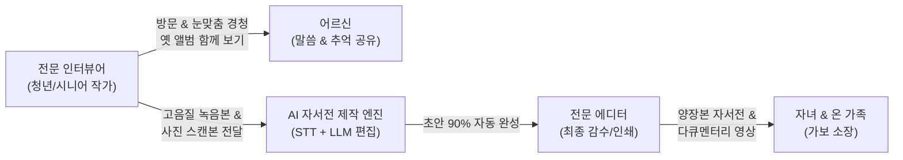

# [기획서] 오프라인 어르신 이야기 경청 및 인생 자서전 프로젝트: "기억정원" (가칭)

> **"손을 맞잡고 앨범을 넘기며 듣는, 세상에서 가장 따뜻한 부모님의 인생 인터뷰"**  
> 전문 인터뷰어가 직접 어르신을 찾아가 옛 앨범을 함께 보며 깊은 이야기를 경청하고, AI 기술로 이를 고급 자서전과 다큐멘터리로 완성하는 **High-Touch & High-Tech 하이브리드 서비스**

---

## 1. 사업 배경 및 핵심 통찰 (Insight)

### 1.1 온라인(전화) 대비 오프라인만의 독보적 강점
1. **비언어적 온기(Human Touch)의 치유력**:
   - 어르신들이 느끼는 고립감은 단순한 '소리의 부재'가 아니라 **'눈맞춤, 맞잡은 손의 온기, 함께 마시는 따뜻한 차 한 잔'** 같은 물리적 실체의 부재에서 옵니다.
2. **'오래된 사진 앨범'과 유품의 힘**:
   - 장롱 깊숙이 묻혀 있던 흑백사진, 낡은 훈장, 첫 월급 명세서, 어머니의 편지 등 **실물 매개체**를 마주할 때 기억의 문이 폭발적으로 열립니다.
3. **손님맞이라는 활력소**:
   - "누군가 내 이야기를 들으러 우리 집에 온다"는 사실만으로도 어르신은 옷을 단정히 입고 집을 청소하며, **'사회적 주체'로서의 자존감과 생기**를 되찾습니다.
4. **높은 지불 의향(WTP)과 프리미엄 객단가**:
   - 매월 몇 만 원 내는 앱/전화 구독보다, 부모님의 칠순·팔순 선물로 **100만~200만 원대 프리미엄 인생 프로젝트**에 자녀들은 훨씬 쉽게 지갑을 엽니다.

---

## 2. 서비스 핵심 컨셉: High-Touch X High-Tech

- **High-Touch (인간의 역할)**: 방문, 공감, 눈맞춤, 경청, 사진 스캔, 정서적 유대 형성.
- **High-Tech (AI의 역할)**: 1시간 분량의 구술 음성을 텍스트화하고, 문맥을 재배치하며, 어르신의 고유한 말맛을 살려 유려한 자서전 문체로 초안 90%를 자동 작성.
  *(→ 기존 수백~수천만 원대 대필 자서전 비용을 1/5 수준으로 낮추는 핵심 동력)*

---

## 3. 대표 서비스 프로그램: "인생 5막(幕) 방문 코스"

어르신 댁(또는 인근 조용한 카페)으로 **주 1회 60~80분씩 총 5회** 방문하여 인생을 테마별로 기록합니다.

| 회차 | 테마 | 주요 인터뷰 내용 및 활동 |
| :---: | :--- | :--- |
| **1회차** | **뿌리와 유년기** *(흙먼지 날리던 고향)* | - 고향 동네 풍경, 부모님과 형제자매 이야기 - 어릴 적 가장 맛있었던 음식과 골목길 놀이 - **[현장 활동]** 가장 오래된 유년기 흑백사진 3장 스캔 |
| **2회차** | **청춘과 불꽃** *(가난을 뚫고 달린 날들)* | - 첫 상경/첫 직장의 떨림, 군 복무 시절, 봉제공장/건설현장 고생담 - 인생에서 가장 찬란했던 20대와 첫 월급의 기억 - **[현장 활동]** 청년 시절 사진 및 상장/훈장/일기장 스캔 |
| **3회차** | **사랑과 보금자리** *(인생의 동반자를 만나다)* | - 배우자와의 첫 만남, 연애와 결혼식 풍경 - 첫 아이를 품에 안았을 때의 벅찬 감정 - 부부 싸움과 화해, 단칸방에서 시작해 집을 늘려가던 보람 |
| **4회차** | **치열했던 부모의 삶** *(자식을 위해 모든 걸 바치다)* | - 자녀들을 키우며 가장 뿌듯했던 순간과 미안했던 순간 - 인생의 가장 큰 위기와 그것을 버텨낸 힘 - **[현장 활동]** 자녀들의 어린 시절 사진 함께 보기 |
| **5회차** | **황혼과 남기고 싶은 말** *(나의 삶은 참 아름다웠다)* | - 지나온 삶을 돌아보며 나 자신에게 해주고 싶은 말 - 자녀와 손주들에게 꼭 남기고 싶은 삶의 지혜와 유언 - **[현장 활동]** 어르신 단독 프로필 인생 사진 촬영 |

---

## 4. 최종 결과물 패키지 (Product Deliverables)

1. **하드커버 양장본 자서전 (100~150페이지 내외, 3~5권)**
   - 고급 친환경 한지 질감 표지, 금박 타이틀 각인.
   - 어르신의 생생한 구술체와 스캔된 옛날 사진들이 어우러진 화보형 자서전.
2. **"목소리로 듣는 부모님" 오디오북 & 인터뷰 다큐 영상**
   - 어르신의 떨리는 육성과 웃음소리가 그대로 담긴 10분 하이라이트 영상 (QR코드로 책에 삽입).
3. **패밀리 전달식 키트**
   - 고급 목함 패키지에 자서전, 감사패, 꽃다발을 동봉하여 가족 모임(환갑/칠순/팔순)에서 전달할 수 있도록 구성.

---

## 5. 인터뷰어(기록관) 인력 운영 및 안전 관리

### 5.1 인터뷰어 채용 및 선발
- **주요 대상**:
  - 문예창작, 국문학, 사회복지, 미디어/신문방송 전공 대학생 (청년 일자리)
  - 은퇴 교원, 사서, 공무원 등 교양과 인내심을 갖춘 '액티브 시니어' (노노케어 모델)
- **자격 요건**:
  - 따뜻한 경청 태도, 어르신과의 라포(Rapport) 형성 능력.

### 5.2 안전 및 신뢰 구축 장치 (Trust & Safety)
- **철저한 신원 보증**: 신원 확인, 성범죄 및 범죄경력 조회 동의서 필수.
- **안심 동행 및 알림**: 인터뷰어 방문 시 자녀에게 시작/종료 실시간 알림톡 발송.
- **배상책임보험 가입**: 방문 중 발생할 수 있는 만약의 사고에 대비한 영업배상책임보험 가입.

---

## 6. 상품 라인업 및 가격 정책 (Pricing)

| 구분 | 라이트 (소망) | 스탠다드 (기억) - **[대표 상품]** | 프리미엄 (영예) |
| :--- | :---: | :---: | :---: |
| **방문 횟수** | 3회 방문 (각 60분) | **5회 방문 (각 70분)** | 8회 방문 (각 80분) |
| **자서전 사양** | 소프트커버 40p (2권) | **고급 양장본 100p (3권)** | 최고급 가죽 양장본 150p (5권) |
| **사진 수록** | 20장 내외 스캔 | **50장 내외 스캔 + 보정** | 100장 스캔 + 복원/컬러화 |
| **영상/음성** | 음성 하이라이트 클립 | **5분 미니 다큐 영상** | **15분 풀 다큐 인터뷰 영상** |
| **가족 행사 지원** | - | 감사패 증정 | **출판기념회 가족 파티 기획 지원** |
| **판매 가격** | **590,000원** | **1,190,000원** | **2,490,000원** |

> **마진 구조 분석 (스탠다드 119만 원 기준)**  
> - 인터뷰어 활동비: 250,000원 (회당 5만 원 × 5회)  
> - 양장본 인쇄/제본(3권): 120,000원  
> - AI 처리 및 에디터 감수비: 80,000원  
> - 패키징 및 배송비: 30,000원  
> - **매출 총이익: 약 710,000원 (영업이익률 약 60%)**

---

## 7. 마케팅 및 유통 전략 (Go-To-Market)

1. **"현금 봉투 대신 평생 남는 책을 선물하세요" (명분 마케팅)**
   - 칠순/팔순/환갑 잔치 때 100~200만 원짜리 명품 가방이나 현금 대신, "자녀들이 모여 부모님께 바치는 인생 헌정서" 프레이밍.
2. **장례/상조 및 웰다잉(Well-Dying) 시장 연계**
   - 상조회사, 호스피스 병원, 프리미엄 실버타운과 제휴하여 "가장 아름다운 엔딩노트이자 기억 유산"으로 판매.
3. **B2G 지자체 역사 기록 사업**
   - "우리 동네 1세대 어르신 구술사 채록 사업"으로 지자체 문화원 및 복지관 예산 수주.

---

## 8. 오프라인 공간 확장 모델: "이야기 다방 (Memory Salon)"

가정 방문이 부담스러운 어르신과 자녀를 위한 **오프라인 거점형 살롱**:
- 7080 감성의 아늑한 레트로 인테리어, 편안한 소파와 잔잔한 옛 노래.
- 자녀와 부모님이 함께 방문하여 차를 마시며 전문 인터뷰어와 1시간 대화를 나누고, 현장에서 옛날 사진을 고해상도로 스캔하는 문화 복합 공간.

---

## 9. 결론 및 로드맵
- **1단계 (단기)**: 인터뷰어 2명(창업자 포함)으로 지인 부모님 3명 대상 5회 방문 파일럿 프로젝트 진행 → 자서전 실물 3권 완성 및 후기 확보.
- **2단계 (중기)**: 크라우드 펀딩(와디즈/텀블벅)에서 "어버이날 부모님 인생 자서전 프로젝트" 펀딩 런칭 (목표 3,000만 원).
- **3단계 (장기)**: 지역별 거점 인터뷰어 네트워크 구축 및 B2G 구술사 아카이빙 사업 확장.

