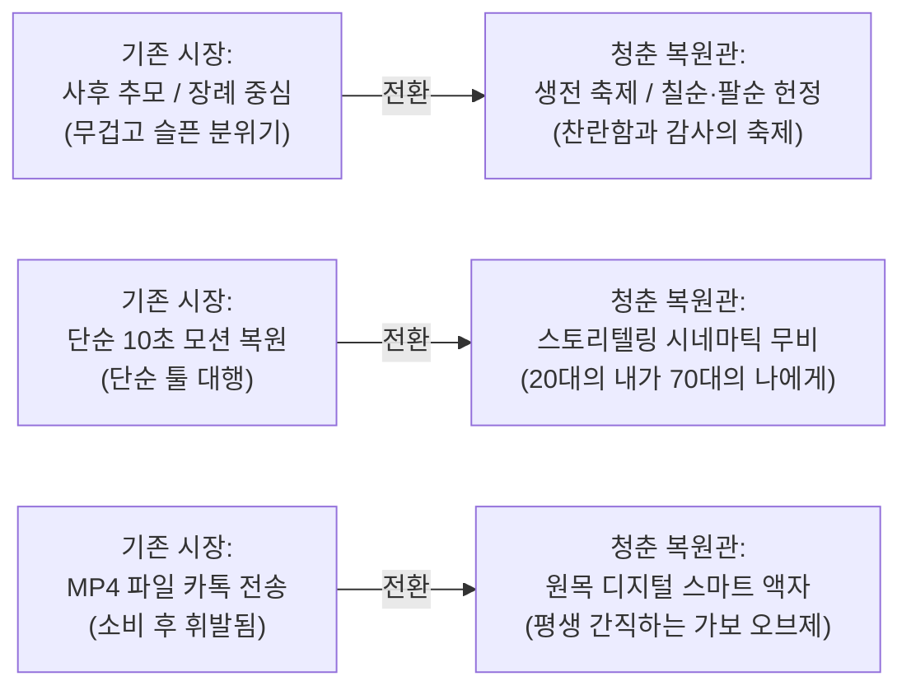
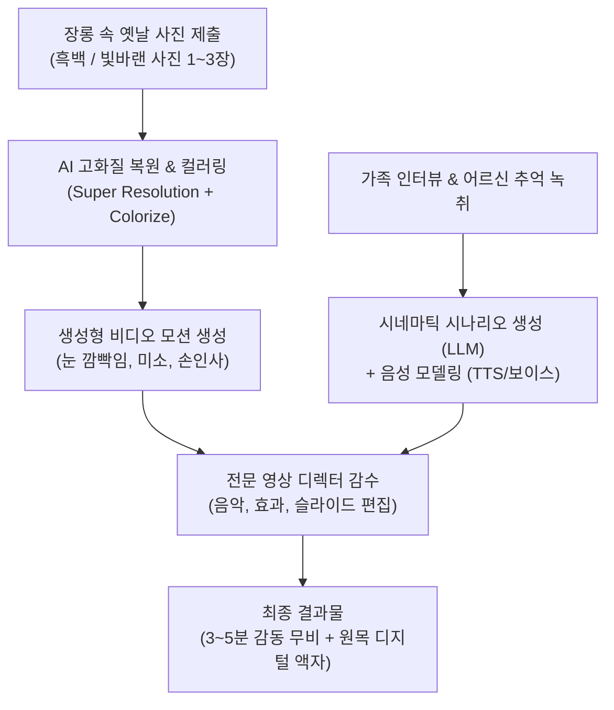

# [기획서] AI 타임머신 시네마틱 헌정관: "청춘 복원관"

> **"영자야, 너 참 곱고 당찼다. 참 잘 살아냈다."**  
> 낡은 흑백사진 속 20대의 부모님이 살아 움직이며, 70대의 현재 부모님과 자녀에게 가슴 벅찬 영상 편지를 건네는 **AI 시네마틱 효도 서비스**

---

## 1. 기획 배경 및 감동 포인트

### 1.1 "부모님에게도 뜨거운 20대 청춘이 있었다"
- 자녀들은 부모님을 태어날 때부터 '엄마', '아빠'라는 주름진 노년의 모습으로만 기억합니다.
- 그러나 장롱 속 앨범을 열어보면, **누구보다 눈부셨던 20대의 청년과 숙녀**가 있습니다.
- 흑백사진 속 20대의 부모님이 생생하게 눈을 깜빡이고, 미소를 지으며 손을 흔들 때 느끼는 감정은 **단순한 복원을 넘어선 거대한 카타르시스와 눈물**입니다.

### 1.2 핵심 타깃 이벤트
- **환갑, 칠순, 팔순 잔치의 하이라이트 영상**: 빔프로젝터에 트는 순간 온 가족이 눈물바다가 되는 감동 헌정 무비.
- **어버이날 / 생신 최고의 선물**: 세상에 단 하나뿐인 프리미엄 효도 선물.

---

## 2. 시장 현황 및 경쟁 분석 (Market & Competitor Analysis)

### 2.1 TV 미디어 및 방송 화제 사례 (대중적 수용성 검증 완료)
1. **SBS 《미운 우리 새끼》 (배우 이동건 편)**:
   - 17년 전 세상을 떠난 남동생의 사진을 AI로 복원하여 **"살아있었다면 37살이 되었을 청년의 모습"**으로 성장 복원한 가족사진을 부모님께 선물. 온 가족과 시청자들에게 폭발적인 눈물과 감동을 선사.
2. **MBC 다큐멘터리 《너를 만났다》 시리즈**:
   - 세상을 떠난 자녀나 부모님을 AI 음성 복제와 실감 그래픽/VR 기술로 구현하여 가족과 재회시킨 다큐멘터리.
3. **지상파 9시 뉴스 (KBS, SBS, JTBC)**:
   - 글로벌 족보 플랫폼 MyHeritage의 **'Deep Nostalgia'**(흑백사진 모션 복원 기술)가 소개되며 "수십 년 전 돌아가신 부모님이 나를 보고 웃으셨다"는 디지털 효도 신드롬 보도.
4. **공익 캠페인 (빙그레 《세상에서 가장 늦은 졸업식》)**:
   - 독립운동가들의 옛 흑백사진을 AI로 복원 및 모션화하여 학사모를 씌워준 캠페인으로 수천만 뷰 기록.

### 2.2 기존 시장 플레이어 한계점 분석

| 구분 | 주요 업체 / 서비스 | 장점 및 특징 | 한계점 (우리의 기회) |
| :--- | :--- | :--- | :--- |
| **대기업형 (엔터프라이즈)** | **딥브레인AI '리메모리(Re;memory)'** | - 대화형 AI 휴먼 구현 - 프리드라이프 등 대형 상조사 제휴 | - **사후 추모/장례(Well-Dying)에 치우쳐 분위기가 무거움** - 수백만 원대 이상의 과도한 고가 책정 |
| **소형 외주형 (스마트스토어)** | **AI 기억공작소, 개인 제작자들** | - 10~20만 원대 저렴한 제작 대행 - 네이버/아이디어스 입점 판매 | - 단순 툴(Remini 등) 대행 수준 (10초 끄덕임) - **스토리텔링, 맞춤 시나리오 및 실물 굿즈 부재** |
| **소비자 셀프 툴** | **Remini, Kling, LivePortrait 등** | - 개인이 직접 스마트폰 앱으로 생성 가능 | - 기술 숙련도 필요, 컷 편집 및 음악 믹싱 불가 - 완성도 높은 시네마틱 무비 연출 불가 |

---

## 3. "청춘 복원관"만의 3대 차별화 전략 (Core Moat)

### 차별화 1. '사후 추모'가 아닌 '생전 축제(Celebration)' 포커스
- 기존 대형 AI 추모 서비스의 무거운 분위기(죽음, 장례, 유골함)를 탈피합니다.
- 살아계실 때 부모님의 지나온 청춘을 기리고 축하해 드리는 **"가족의 가장 화려한 축제 헌정 영화"**로 포지셔닝합니다.

### 차별화 2. 독창적 시나리오 연출: "20대의 내가 70대의 나에게"
- 단순한 얼굴 움직임이 아니라, 자녀와의 사전 인터뷰 내용을 바탕으로 **스물두 살의 어머니가 칠순의 어머니에게 건네는 위로의 편지**를 AI 시나리오로 구현합니다.
- *"영자야, 네가 앞으로 겪을 고생 내가 다 알지만 넌 참 잘 해낼 거야. 네 주름진 얼굴도 정말 눈부셔."*

### 차별화 3. 디지털 파일을 넘어선 실물 오브제 (원목 IPS 스마트 액자)
- MP4 동영상 파일만 카카오톡으로 전달하면 금방 잊힙니다.
- 전원만 꽂으면 안방 화장대나 거실장에서 평생 20대의 부모님이 미소 지으며 말을 건네는 **'전용 원목 스마트 디지털 액자'**를 세트로 제공하여 40~60만 원대 프리미엄 가격을 정당화합니다.

---

## 4. 제작 프로세스 및 AI 기술 파이프라인

---

## 5. 상품 패키지 및 가격 모델 (Pricing)

| 상품 등급 | 구성 내역 | 판매 가격 |
| :--- | :--- | :---: |
| **베이직 (디지털 싱글)** | - 흑백사진 1장 초고화질 컬러 복원 - 15초 AI 모션 영상 + 감사 음성 편지 - 모바일 공유용 4K 비디오 파일 제공 | **190,000원** |
| **스탠다드 (시네마틱 헌정)** *(대표 상품)* | - 흑백사진 3장 복원 & 모션 비디오 - **3~5분 분량의 풀 시네마틱 헌정 무비** (가족 영상 편지 포함) - 원목 복원 사진 액자 1점 제공 | **390,000원** |
| **프리미엄 (타임머신 오브제)** | - 스탠다드 풀 영상 포함 - **전원만 켜면 무한 재생되는 고급 원목 디지털 액자(IPS 패널)** - 고급 비단 패키지 박스 + 감사패 세트 | **690,000원** |

> **원가 및 수익성 분석 (스탠다드 39만 원 기준)**:
> - AI 영상 렌더링 및 클라우드 비용: 약 15,000원
> - 영상 전문 편집자 인건비 (템플릿 기반): 약 80,000원
> - 실물 액자 및 배송비: 약 25,000원
> - **매출 총이익: 약 270,000원 (마진율 약 70%)**

---

## 6. 마케팅 및 바이럴 전략

1. **인스타그램 / 틱톡 '리액션 영상' 바이럴**:
   - 자녀들이 부모님께 이 영상을 처음 보여드렸을 때, 부모님이 멍하니 화면을 보시다가 눈물을 흘리시는 리액션 카메라 쇼츠/릴스 제작. (조회수 보장형 킬러 콘텐츠)
2. **웨딩 및 장례/추모 시장 연계**:
   - **결혼식 부모님 감사 영상**: 신랑/신부가 부모님께 바치는 식전 영상으로 제휴.
   - **추모 아카이빙**: 고인이 되신 부모님의 생전 모습을 그리워하는 유가족을 위한 메모리얼 영상.
3. **크라우드 펀딩 (와디즈/텀블벅)**:
   - "어버이날, 부모님께 청춘을 돌려드립니다" 프로젝트로 런칭 시 얼리어답터 자녀들의 폭발적 참여 유도.

---

## 7. 단계별 실행 계획 (Roadmap)
- **1단계 (파일럿 제작 - 2주)**: 실제 팀원/지인 부모님 옛날 흑백사진 2건으로 샘플 영상 2편 제작 (포트폴리오 확보).
- **2단계 (인스타 바이럴 테스트 - 1개월)**: 부모님 리액션 숏폼 영상 업로드 후 사전 예약 랜딩페이지 오픈.
- **3단계 (정식 웹 플랫폼 런칭 - 3개월)**: 사진 업로드부터 시나리오 작성, 디지털 액자 배송까지 원스톱 자동화 시스템 구축.
