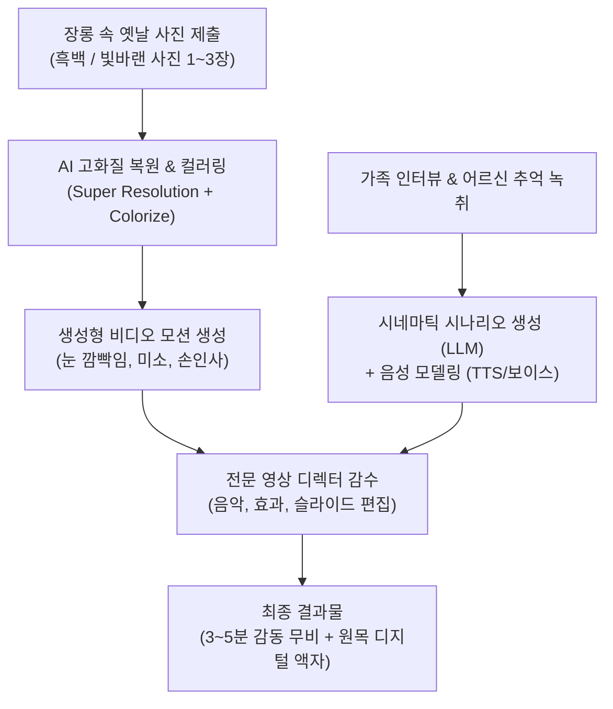

# [기획서] AI 타임머신 시네마틱 헌정관: "청춘 복원관"

> **"영자야, 너 참 곱고 당찼다. 참 잘 살아냈다."**  
> 낡은 흑백사진 속 20대의 부모님이 살아 움직이며, 70대의 현재 부모님과 자녀에게 가슴 벅찬 영상 편지를 건네는 **AI 시네마틱 효도 서비스**

---

## 1. 기획 배경 및 감동 포인트

### 1.1 "부모님에게도 뜨거운 20대 청춘이 있었다"
- 자녀들은 부모님을 태어날 때부터 '엄마', '아빠'라는 주름진 노년의 모습으로만 기억합니다.
- 그러나 장롱 속 앨범을 열어보면, **누구보다 눈부셨던 20대의 청년과 숙녀**가 있습니다.
- 흑백사진 속 20대의 부모님이 생생하게 눈을 깜빡이고, 미소를 지으며 손을 흔들 때 느끼는 감정은 **단순한 복원을 넘어선 거대한 카타르시스와 눈물**입니다.

### 1.2 핵심 타깃 이벤트
- **환갑, 칠순, 팔순 잔치의 하이라이트 영상**: 빔프로젝터에 트는 순간 온 가족이 눈물바다가 되는 감동 헌정 무비.
- **어버이날 / 생신 최고의 선물**: 세상에 단 하나뿐인 프리미엄 효도 선물.

---

## 2. 제작 프로세스 및 AI 기술 파이프라인

### [영상 연출 시나리오 예시]
1. **인트로 (과거로의 여행)**: 잔잔한 피아노 선율과 함께 흑백사진이 화면에 떠오르고, 색이 서서히 입혀집니다.
2. **청춘의 소환**: 20대의 어머니(사진 속 인물)가 살며시 고개를 들며 미소를 짓고, 카메라를 바라봅니다.
3. **20대의 내가 70대의 나에게**:
   > *"영자야, 안녕? 스물두 살의 너야.  
   > 네가 앞으로 걸어갈 길에 험한 고개도 많고 눈물 흘릴 날도 많겠지만...  
   > 넌 누구보다 훌륭하게 자식들을 키워냈고 당당하게 살아냈어.  
   > 주름진 네 얼굴도 정말 아름답다. 영자야, 참 고생 많았다. 고맙다."*
4. **아웃트로**: 자녀들의 감사 메시지와 가족사진들이 겹쳐지며 웅장한 감동으로 마무리.

---

## 3. 상품 패키지 및 가격 모델 (Pricing)

| 상품 등급 | 구성 내역 | 판매 가격 |
| :--- | :--- | :---: |
| **베이직 (디지털 싱글)** | - 흑백사진 1장 초고화질 컬러 복원 - 15초 AI 모션 영상 + 감사 음성 편지 - 모바일 공유용 4K 비디오 파일 제공 | **190,000원** |
| **스탠다드 (시네마틱 헌정)** *(대표 상품)* | - 흑백사진 3장 복원 & 모션 비디오 - **3~5분 분량의 풀 시네마틱 헌정 무비** (가족 영상 편지 포함) - 원목 복원 사진 액자 1점 제공 | **390,000원** |
| **프리미엄 (타임머신 오브제)** | - 스탠다드 풀 영상 포함 - **전원만 켜면 무한 재생되는 고급 원목 디지털 액자(IPS 패널)** - 고급 비단 패키지 박스 + 감사패 세트 | **690,000원** |

> **원가 및 수익성 분석 (스탠다드 39만 원 기준)**:
> - AI 영상 렌더링 및 클라우드 비용: 약 15,000원
> - 영상 전문 편집자 인건비 (템플릿 기반): 약 80,000원
> - 실물 액자 및 배송비: 약 25,000원
> - **매출 총이익: 약 270,000원 (마진율 약 70%)**

---

## 4. 마케팅 및 바이럴 전략

1. **인스타그램 / 틱톡 '리액션 영상' 바이럴**:
   - 자녀들이 부모님께 이 영상을 처음 보여드렸을 때, 부모님이 멍하니 화면을 보시다가 눈물을 흘리시는 리액션 카메라 쇼츠/릴스 제작. (조회수 보장형 킬러 콘텐츠)
2. **웨딩 및 장례/추모 시장 연계**:
   - **결혼식 부모님 감사 영상**: 신랑/신부가 부모님께 바치는 식전 영상으로 제휴.
   - **추모 아카이빙**: 고인이 되신 부모님의 생전 모습을 그리워하는 유가족을 위한 메모리얼 영상.
3. **크라우드 펀딩 (와디즈/텀블벅)**:
   - "어버이날, 부모님께 청춘을 돌려드립니다" 프로젝트로 런칭 시 얼리어답터 자녀들의 폭발적 참여 유도.

---

## 5. 단계별 실행 계획 (Roadmap)
- **1단계 (파일럿 제작 - 2주)**: 실제 팀원/지인 부모님 옛날 흑백사진 2건으로 샘플 영상 2편 제작 (포트폴리오 확보).
- **2단계 (인스타 바이럴 테스트 - 1개월)**: 부모님 리액션 숏폼 영상 업로드 후 사전 예약 랜딩페이지 오픈.
- **3단계 (정식 웹 플랫폼 런칭 - 3개월)**: 사진 업로드부터 시나리오 작성, 디지털 액자 배송까지 원스톱 자동화 시스템 구축.

