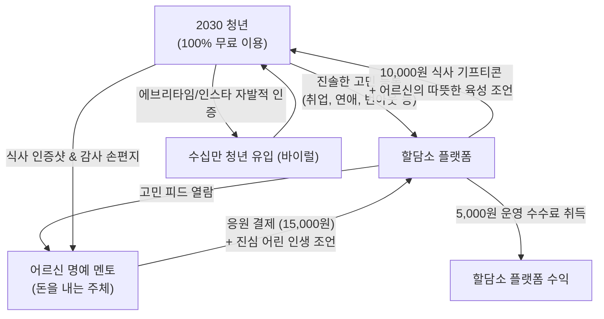

# [기획서] 역발상 세대 상생 플랫폼: "할담소 (랜선 밥 사주는 어른)"

> **"힘들지? 밥이나 든든하게 챙겨 먹고 다시 일어서라."**  
> 청년은 **100% 무료로 따뜻한 위로와 밥 한 끼(기프티콘)**를 얻고,  
> 어르신은 **돈을 내고 청년의 존경과 삶의 의미(자존감)**를 얻는 역발상 세대 상생 플랫폼

---

## 1. 기획 배경 및 역발상 통찰 (The Reverse Insight)

### 1.1 시장의 경제적·심리적 모순
- **2030 청년 세대**:
  - 취업난, 고물가, 주거 불안 속에서 극심한 번아웃과 우울을 겪고 있으나 **지갑이 닫혀 있어 유료 상담을 받을 여력이 없습니다.**
- **6070 액티브 시니어 세대**:
  - 대한민국 역사상 가장 자산이 많고 시간적 여유가 넘쳐나지만, 은퇴 후 **"사회적 쓸모 상실", "내 말을 귀담아들을 청중의 부재", "고독감"**에 시달립니다.
- **기존 서비스의 실패 원인**:
  - 돈 없는 청년에게 상담료를 받으려 했기 때문에 트래픽이 모이지 않았습니다.

### 1.2 왜 어르신이 돈을 내고 답변하는가? (지불 심리의 본질)
1. **"밥 살 테니 내 얘기 좀 들어봐"의 디지털화**:
   - 현실에서도 어르신들이 후배나 젊은이들에게 흔쾌히 5만~10만 원 밥값을 쓰는 이유는 **'어른 대접을 받고 내 삶의 지혜를 인정받는 쾌감'** 때문입니다.
2. **단돈 15,000원으로 사는 인생 최고의 도파민**:
   - 사기나 다단계에 수백만 원을 뜯기는 어르신들의 근본 심리는 "선생님, 대단하세요!"라는 인정 욕구입니다.
   - 단돈 15,000원으로 *"할아버지 덕분에 국밥 든든하게 먹고 다시 힘내서 면접 보러 갑니다. 평생 은혜 잊지 않겠습니다"*라는 20대 청년의 눈물 어린 손편지 답장을 받는 것은 어르신에게 무엇과도 바꿀 수 없는 행복입니다.
3. **에릭슨의 '생산성(Generativity)' 충족**:
   - 다음 세대의 성장을 돕고 사회에 긍정적 유산을 남겼다는 깊은 자아통합감을 획득합니다.

---

## 2. 서비스 핵심 메커니즘 (The Reverse Flywheel)

### [실제 사용자 경험 시나리오]
1. **청년의 무료 고민 등록**:
   - 27세 취준생: *"서류만 50번째 탈락했습니다. 제 존재 자체가 실패작 같아요. 부모님 볼 면목도 없습니다."*
2. **어르신의 응원 펀딩 결제 (15,000원)**:
   - 71세 김종석 어르신이 글을 읽고 눈시울을 붉히며 **'따뜻한 국밥 한 그릇 선물하기(15,000원)'** 결제.
   - 어르신의 조언 녹음:
     > *"아가야, 나도 젊었을 적에 첫 직장에서 잘리고 한강 다리 밑에서 며칠을 울었다. 근데 살아보니 그건 실패가 아니라 더 좋은 길을 가기 위한 우회로였어. 넌 절대로 실패작이 아니다. 내가 국밥 한 그릇 보낼 테니 굶지 말고 든든하게 먹어라. 할애비가 뒤에서 응원한다."*
3. **청년의 수혜 및 눈물의 인증**:
   - 청년에게 10,000원 상당의 식사 기프티콘과 어르신의 육성 오디오 카드 도착.
   - 청년은 국밥집에서 눈물을 흘리며 뚝배기 완식 인증 사진과 감사의 장문 답장을 보냄.
   - 이 인증글이 대학생 커뮤니티(에브리타임)와 SNS에 퍼지며 **"진짜 어른이 있는 힐링 플랫폼"**으로 폭발적 화제화.

---

## 3. 핵심 시스템 및 운영 설계

### 3.1 품격 있는 어른을 위한 '안티-꼰대(Anti-Kkondae)' 필터링
- 돈을 낸다고 해서 청년에게 상처를 주는 훈계를 허용하지 않습니다.
- **AI 사전 윤문 및 가이드**:
  - 비방, 정치적 발언, "노력이 부족하다" 등의 꼰대 발언 감지 시 AI가 부드럽게 재작성을 유도:
    *"어르신, 조언의 뜻은 훌륭하지만 '요즘 애들은' 대신 '젊은 시절 나도 그랬단다'로 표현하시면 청년이 훨씬 큰 감동을 받습니다."*

### 3.2 성향별 4대 명예 멘토 페르소나
어르신들은 가입 시 본인의 인생 경험에 따라 멘토 성향을 선택하여 활동합니다:
1. **순자 할머니 (츤데레 팩폭형)**: "정신 안 차려? 밥은 먹고 우냐? 국밥 먹고 기운 차려!" (연애, 생활습관 전문)
2. **옥분 할머니 (따뜻한 감성형)**: "아가야, 봄꽃이 일찍 핀다고 가을 국화가 슬퍼하더냐." (자존감, 번아웃 전문)
3. **덕배 할아버지 (산전수전 승부사형)**: "내가 사업 부도 3번 맞아봤는데 이건 찰과상이야." (취업, 이직, 재도전 전문)
4. **종석 할아버지 (낭만 로맨티스트형)**: "사람 마음은 계산하는 게 아니란다." (결혼, 인간관계 전문)

### 3.3 철저한 안전 및 프라이버시 보호 (Trust & Safety)
- **100% 비대면 디지털 교류**: 개인 연락처 노출, 사적 만남, 오프라인 접촉 원천 차단.
- 모든 식사 선물은 모바일 기프티콘(배민, 올리브영, 편의점, 식당) 형태로만 플랫폼 내에서 안전하게 중개.

---

## 4. 비즈니스 모델 및 유닛 이코노믹스 (BM)

### 4.1 건당 밥값 후원 모델 (단건 결제)
- **어르신 결제 금액**: **15,000원**
  - **청년 혜택**: 10,000원 모바일 식사 상품권 지급
  - **플랫폼 수익**: **5,000원 (수수료율 33.3%)**
  - *제공 가치: 어르신에게는 청년의 감동 후기 및 '오늘의 명예 어른' 칭호 부여*

### 4.2 시니어 '명예 멘토 클럽' 정기 멤버십 (월 구독)
- **멤버십 회비**: **월 39,000원**
  - **구성**: 매월 2명의 청년에게 식사 기프티콘 자동 후원 + 전용 멘토 배지 부여
  - **오프라인 혜택**: 연 2회 호텔 오프라인 '할담소 명예 멘토 감사의 밤' 만찬 초대 (시니어 소셜 네트워킹)
  - **플랫폼 순이익**: 건당 약 19,000원 확보

### 4.3 B2G 및 대기업 ESG 사회공헌 스폰서십
- **기업 CSR 펀딩**: "현대차/SK와 함께하는 청년 밥상 & 시니어 멘토링 캠페인" 형태로 대기업 후원 유치.
- **정부 예산 수주**: 보건복지부 '청년 고립·은둔 예방 사업' 및 '노인 사회참여 활성화 기금' 결합.

---

## 5. 단계별 런칭 및 실행 로드맵 (Roadmap)

### Phase 1: 무자본 인스타그램 & 에브리타임 MVP (1개월)
- 대학생 커뮤니티(에브리타임)에서 취준생 고민 20건 무료 접수.
- 창업자 지인 및 은퇴 액티브 시니어 5명 모집 → 어르신들이 1만 원씩 자발적으로 밥값을 쏘며 음성 녹음 전달.
- 청년들의 오열 인증샷을 카드뉴스와 숏폼(릴스)으로 제작해 인스타그램 배포 → 초기 팬덤 구축.

### Phase 2: 공식 웹 플랫폼 런칭 (2~3개월)
- "랜선 밥 사주는 어른" 웹 서비스 오픈.
- 어르신 전용 큰 글씨 결제/답변 페이지 및 청년 무료 익명 고민 게시판 구현.
- 모바일 기프티콘 자동 발송 파이프라인 연동.

### Phase 3: '명예 멘토 클럽' 앱 출시 및 ESG 확대 (4~6개월)
- 시니어 전용 모바일 앱 런칭 및 월 정기 구독 멤버십 도입.
- 대학 총학생회 및 지자체 청년 센터와 공식 업무협약(MOU) 체결.

---

## 6. 기대 효과 및 핵심 비전
- **청년**: 돈 걱정 없이 가장 힘들 때 인생 선배의 따뜻한 위로와 따뜻한 밥 한 끼로 다시 살아갈 용기를 얻음.
- **어르신**: 은퇴 후 잃어버렸던 사회적 존경과 자아통합감을 회복하고, 자랑스러운 '어른'으로 우뚝 섬.
- **사회**: 세대 갈등으로 찢어진 대한민국에서 세대와 세대가 사랑과 밥으로 연결되는 가장 아름다운 세대 상생의 장 완성.
