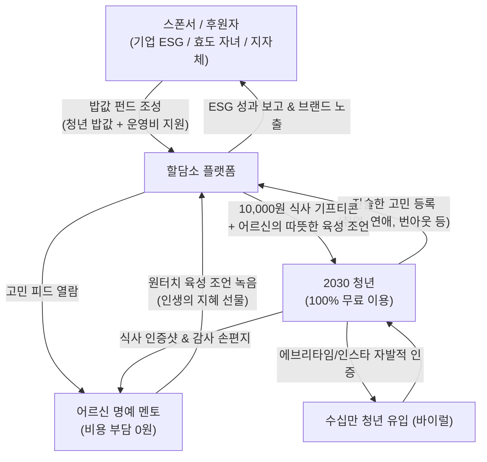

# [기획서] 역발상 세대 상생 플랫폼: "할담소 (랜선 밥 사주는 어른)"

> **"힘들지? 밥이나 든든하게 챙겨 먹고 다시 일어서라."**  
> 청년은 **100% 무료로 따뜻한 위로와 밥 한 끼(기프티콘)**를 얻고,  
> 어르신은 **비용 부담 없이 오직 인생의 지혜와 따뜻한 마음**으로 청년의 존경과 자아통합감을 얻으며,  
> 밥값과 운영비는 **기업 ESG·자녀 효도 구독·지자체 복지 기금**이 후원하는 지속 가능한 세대 상생 플랫폼.

---

## 1. 기획 배경 및 역발상 통찰 (The Reverse Insight)

### 1.1 시장의 경제적·심리적 모순
- **2030 청년 세대**:
  - 취업난, 고물가, 주거 불안 속에서 극심한 번아웃과 우울을 겪고 있으나 **지갑이 닫혀 있어 유료 상담을 받을 여력이 없습니다.**
- **6070 시니어 세대**:
  - 은퇴 후 **"사회적 쓸모 상실", "내 말을 귀담아들을 청중의 부재", "고독감"**에 시달립니다.
  - 하지만 **스마트폰 결제나 계좌이체는 인증/보안의 벽이 너무 높아 모바일 결제 완주율이 극히 낮습니다.**
- **핵심 역발상 피봇 (BM 전환)**:
  - *"어르신에게 직접 결제를 요구하지 말자!"*
  - 어르신은 **'값진 인생 지혜(콘텐츠 공급자)'**로서 0원으로 참여하게 하고, 비용은 **청년 지원과 시니어 복지를 원하는 기업(ESG), 3040 자녀(효도 선물), 지자체(청년·노인 복지 기금)**가 지불하도록 설계합니다.

---

## 2. 서비스 핵심 메커니즘 (The Reverse Flywheel)

### [실제 사용자 경험 시나리오]
1. **청년의 무료 고민 등록**:
   - 27세 취준생: *"서류만 50번째 탈락했습니다. 제 존재 자체가 실패작 같아요. 부모님 볼 면목도 없습니다."*
2. **어르신의 원터치 육성 조언 (결제 없음)**:
   - 71세 김종석 어르신이 글을 읽고 눈시울을 붉히며 큰 글씨 마이크 버튼을 누르고 말씀하심:
     > *"아가야, 나도 젊었을 적에 첫 직장에서 잘리고 한강 다리 밑에서 며칠을 울었다. 근데 살아보니 그건 실패가 아니라 더 좋은 길을 가기 위한 우회로였어. 넌 절대로 실패작이 아니다. 굶지 말고 든든하게 먹어라. 할애비가 뒤에서 응원한다."*
3. **청년의 수혜 및 눈물의 인증**:
   - 청년에게 10,000원 상당의 식사 기프티콘과 어르신의 육성 오디오 카드 도착 (스폰서: "배달의민족/신한금융이 함께합니다").
   - 청년은 국밥집에서 눈물을 흘리며 뚝배기 완식 인증 사진과 감사의 장문 답장을 보냄.
   - 이 인증글이 대학생 커뮤니티(에브리타임)와 SNS에 퍼지며 **"진짜 어른이 있는 힐링 플랫폼"**으로 폭발적 화제화.

---

## 3. 핵심 시스템 및 운영 설계

### 3.1 품격 있는 어른을 위한 '안티-꼰대(Anti-Kkondae)' 필터링
- **AI 사전 윤문 및 가이드**:
  - 비방, 비교, "라떼는 말이야" 식 훈계 감지 시 AI가 부드럽게 재작성을 유도:
    *"어르신, 조언의 뜻은 훌륭하지만 '요즘 애들은' 대신 '젊은 시절 나도 그랬단다'로 표현하시면 청년이 훨씬 큰 감동을 받습니다."*

### 3.2 성향별 4대 명예 멘토 페르소나
1. **순자 할머니 (츤데레 팩폭형)**: "정신 안 차려? 밥은 먹고 우냐? 국밥 먹고 기운 차려!" (연애, 생활습관 전문)
2. **옥분 할머니 (따뜻한 감성형)**: "아가야, 봄꽃이 일찍 핀다고 가을 국화가 슬퍼하더냐." (자존감, 번아웃 전문)
3. **덕배 할아버지 (산전수전 승부사형)**: "내가 사업 부도 3번 맞아봤는데 이건 찰과상이야." (취업, 이직, 재도전 전문)
4. **종석 할아버지 (낭만 로맨티스트형)**: "사람 마음은 계산하는 게 아니란다." (결혼, 인간관계 전문)

### 3.3 철저한 안전 및 프라이버시 보호 (Trust & Safety)
- **100% 비대면 디지털 교류**: 개인 연락처 노출, 사적 만남, 오프라인 접촉 원천 차단.
- 모든 식사 선물은 모바일 기프티콘(배민, 올리브영, 편의점, 식당) 형태로만 플랫폼 내에서 안전하게 중개.

---

## 4. 비즈니스 모델 및 유닛 이코노믹스 (BM 재검토 안)

> **💡 핵심 전략**: 어르신의 결제 허들(계좌이체/카드 결제 이탈)을 원천 차단하기 위해, **어르신 0원 무료 모델**을 전제로 외부 지불 용의(WTP)를 결합합니다.

### 4.1 모델 A: 기업 ESG / CSR 스폰서십 매칭 (B2B)
- **개념**: 식품 대기업, 배달 플랫폼, 금융권 ESG 펀드가 청년 밥값과 운영비를 전액 후원.
- **수익 구조**:
  - 기업 후원금: 건당 15,000원 (청년 식사 10,000원 + 플랫폼 운영비/수수료 5,000원)
  - 기업 혜택: "OO기업과 함께하는 청년 응원 국밥 10,000그릇 캠페인" 전면 브랜드 노출 및 ESG 정량 리포트 제공.

### 4.2 모델 B: 3040 자녀의 '효도 선물 패키지' 구독 (B2C)
- **개념**: 결제 능력이 있는 3040 자녀가 부모님의 우울감 해소와 활력을 위해 대신 정기 결제.
- **수익 구조**:
  - **월 29,900원 구독권**: 부모님 계정으로 '청년 밥 사주기 2회권(20,000원 상당)' 자동 충전.
  - **플랫폼 마진**: 구독 건당 약 9,900원 수익.
  - 자녀 혜택: 부모님이 청년에게 조언을 남기고 감사 편지를 받을 때마다 자녀에게도 알림톡 전송 ("오늘 어머니께서 취준생 청년에게 따뜻한 국밥을 선물하셨습니다").

### 4.3 모델 C: 지자체 청년 케어 & 노인 복지 바우처 (B2G)
- **개념**: 보건복지부 및 지자체(서울시 청년청 등)의 '고립 청년 발굴' 및 '노인 사회참여' 공공사업 수주.
- **수익 구조**: 공공 위탁 운영 수수료 및 정책 바우처 기금 정산.

---

## 5. 단계별 런칭 및 실행 로드맵 (Roadmap)

### Phase 1: 감동 검증 및 무과금 바이럴 MVP (1개월)
- 대학생 커뮤니티(에브리타임) 취준생 고민 30건 접수.
- 초기 시니어 멘토단 10명 모집 (자체 시드 기금 50만 원으로 밥값 전액 무료 지원).
- 청년들의 오열 인증샷을 카드뉴스와 숏폼(릴스)으로 제작해 인스타그램 배포 → 팬덤 구축.

### Phase 2: 효도 구독(B2C) & 기업 ESG(B2B) 런칭 (2~3개월)
- 3040 자녀 대상 "부모님께 자존감을 선물하세요" 효도 구독 랜딩 페이지 오픈.
- 초기 바이럴 지표를 기반으로 식품/배달 대기업 대상 ESG 제안서 피칭.

### Phase 3: 지자체 MOU 및 오프라인 명예의 전당 (4~6개월)
- 지자체 청년 센터 및 노인복지관과 공식 협약.
- 연말 청년과 어르신이 한자리에 모이는 '할담소 따뜻한 밥상의 밤' 만찬 행사 개최.

---

## 6. 기대 효과 및 핵심 비전
- **청년**: 돈 걱정 없이 가장 힘들 때 인생 선배의 따뜻한 위로와 따뜻한 밥 한 끼로 다시 살아갈 용기를 얻음.
- **어르신**: 복잡한 결제 스트레스 없이 평생 쌓은 지혜로 청년을 살리고, 자랑스러운 '어른'으로 우뚝 섬.
- **사회**: 세대 갈등으로 찢어진 대한민국에서 세대와 세대가 사랑과 밥으로 연결되는 가장 아름다운 세대 상생의 장 완성.
