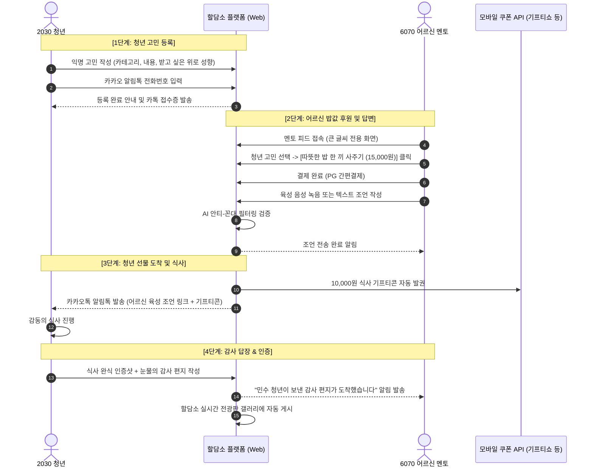
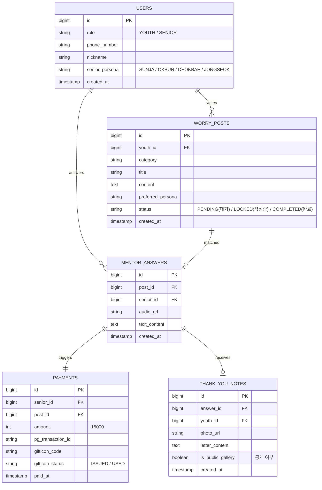

# [PRD] 할담소 (랜선 밥 사주는 어른) 제품 요구사항 정의서

| 항목 | 내용 |
| :--- | :--- |
| **문서 버전** | v1.0 (MVP) |
| **작성일** | 2026-11-03 |
| **문서 상태** | Draft (기획 승인 완료) |
| **대상 플랫폼** | 모바일 반응형 웹 (Mobile-First Web) |
| **주요 사용자** | 청년(2030 고민 작성자), 어르신(6070 명예 멘토 후원자) |

---

## 1. 제품 목적 및 핵심 가치 (Product Goal)
- **청년 (Youth)**: 비용 부담 제로(0원)로 인생 고민을 털어놓고, 따뜻한 인생 조언과 함께 **실제 식사 기프티콘(10,000원)**을 지원받아 위로와 물리적 에너지를 얻음.
- **어르신 (Senior)**: 15,000원을 결제하여 청년에게 밥을 사주고 지혜를 나누며, **"사회적 존경, 인정, 살아있는 삶의 보람"**을 획득함.
- **플랫폼 (Hal-Dam-So)**: 결제 건당 5,000원의 운영 수수료를 확보하며, 세대 상생 트래픽과 바이럴을 창출함.

---

## 2. 유저 페르소나 및 핵심 문제

### 2.1 청년 페르소나 (김민수, 26세, 취업준비생)
- **Pain Point**: 서류 탈락 연속, 통장 잔고 바닥, 부모님과 친구들에게 털어놓지 못하는 불안감과 자책감.
- **Needs**: 평가나 훈계 없는 무조건적인 내 편, 그리고 오늘 저녁 배를 채워줄 따뜻한 국밥 한 그릇.

### 2.2 어르신 페르소나 (박덕배, 69세, 은퇴 공직자)
- **Pain Point**: 은퇴 후 자산과 연금은 충분하나 하루 종일 찾는 사람이 없음. 사회에서 쓸모없는 늙은이가 된 것 같은 무력감.
- **Needs**: 젊은 친구들에게 밥 사주며 대접받던 활력, 내 경험이 누군가에게 도움이 된다는 존재 가치.

---

## 3. 핵심 유저 저니 및 플로우 (User Flow)

---

## 4. 기능 요구사항 명세 (Functional Specs)

### 4.1 청년 기능 (Youth Portal)

| ID | 기능명 | 설명 | 우선순위 |
| :--- | :--- | :--- | :---: |
| **FR-Y01** | **익명 고민 작성기** | - 제목(최대 40자), 본문(최대 1,000자) - 카테고리: 취업/진로, 연애/이별, 번아웃/우울, 가족/인간관계 - 희망 멘토 성향 선택: 츤데레 팩폭 / 따뜻한 위로 / 산전수전 돌파 / 낭만 조언 | **P0 (필수)** |
| **FR-Y02** | **카카오 알림톡 수신 동의** | - 별도 회원가입 없이 휴대폰 번호 본인 인증 1회로 접수 완료 | **P0 (필수)** |
| **FR-Y03** | **선물 수신 뷰어** | - 어르신의 육성 오디오 플레이어 (배경음악 자동 믹싱) - 10,000원 모바일 식사 기프티콘 바코드 표출 (배민/편의점/식당권) | **P0 (필수)** |
| **FR-Y04** | **식사 인증 & 감사 편지 작성** | - 식사 사진 업로드 (최대 2장) - 어르신께 드리는 감사 손편지 텍스트 (최소 50자 이상 필수) | **P0 (필수)** |

---

### 4.2 어르신 기능 (Senior Mentor Portal)

| ID | 기능명 | 설명 | 우선순위 |
| :--- | :--- | :--- | :---: |
| **FR-S01** | **실버 친화 전용 UI** | - 기본 폰트 22pt 이상, 고대비 파스텔 배경, 큼직한 터치 영역 | **P0 (필수)** |
| **FR-S02** | **고민 피드 브라우징** | - 실시간 청년 고민 카드 열람 (음성 낭독 듣기 지원) - '아직 밥을 못 먹은 청년(미매칭)' 우선 정렬 | **P0 (필수)** |
| **FR-S03** | **밥값 후원 결제** | - 단건 15,000원 결제 (간편 카드등록 / 토스페이 / 카카오페이 지원) - 결제 완료 시 해당 고민 글 1시간 동안 '작성 중(Lock)' 처리 | **P0 (필수)** |
| **FR-S04** | **조언 입력기 (음성 / 텍스트)** | - **[원터치 마이크 녹음]**: 최대 3분 육성 녹음 지원 (노이즈 자동 제거) - **[큰 글씨 자판 입력]**: 텍스트 작성 지원 | **P0 (필수)** |
| **FR-S05** | **AI 안티-꼰대 실시간 필터** | - 비하, 비교, 정치, 비난 표현 감지 시 친절한 팝업 가이드 안내 - *"어르신, 조금 더 부드러운 격려의 말씀으로 다듬어 드릴까요?"* | **P0 (필수)** |
| **FR-S06** | **보람 피드 (내 손주 소식)** | - 내가 밥을 사준 청년들의 식사 인증 사진 및 감사 편지 모아보기 보관함 | **P0 (필수)** |

---

## 5. 데이터베이스(DB) 엔티티 모델링

---

## 6. 비즈니스 정책 및 예외 처리 (Business Rules & Edge Cases)

1. **중복 매칭 방지 (동시 결제 충돌 Lock 정책)**:
   - 한 고민 글에는 **단 1명의 어르신만 밥값을 후원**할 수 있습니다.
   - 어르신이 결제 페이지로 진입하면 해당 고민 글은 10분간 `LOCKED` 상태가 되며, 10분 내 결제가 안 되면 자동 해제됩니다.
2. **결제 후 답변 미작성 처리**:
   - 어르신이 결제 후 1시간 이내에 음성/글 답변을 제출하지 않을 경우, 결제는 자동 취소(전액 환불)되고 고민 글은 다시 대기 상태로 전환됩니다.
3. **개인 연락처 및 사적 만남 원천 차단 (Zero-Contact Policy)**:
   - 본문 및 답변 내 전화번호, 카카오톡 ID, 계좌번호, 특정 만남 장소 언급 시 정규식(Regex)과 AI 필터가 감지하여 등록을 차단합니다.
4. **미매칭 고민 글 처리**:
   - 등록 후 72시간 동안 어르신 매칭이 되지 않은 청년 고민은 피드 상단으로 자동 부스팅되며, 주 1회 '할담소 운영팀 명예 멘토단'이 직접 밥값을 쏘며 지원합니다.

---

## 7. 단계별 개발 마일스톤 (MVP 6주 계획)

- **Sprint 1 (1~2주 차)**:
  - 반응형 모바일 웹 기본 프레임워크 구축 (Next.js / TailwindCSS)
  - 청년 익명 고민 작성 및 카카오 알림톡 연동
- **Sprint 2 (3~4주 차)**:
  - 어르신 전용 큰 글씨 피드 및 오디오 녹음 파이프라인
  - 토스페이먼츠(PG) 결제 연동 (15,000원 결제)
  - 모바일 쿠폰 발급 API 연동 (기프티쇼/즐거운 등 연동)
- **Sprint 3 (5주 차)**:
  - OpenAI GPT 기반 안티-꼰대 실시간 필터링 모듈 탑재
  - 청년 감사 손편지 & 식사 인증샷 업로드 뷰어 개발
- **Sprint 4 (6주 차)**:
  - 내부 알파 테스트 (대학생 10명 + 시니어 5명 실거래 테스트)
  - 에브리타임/인스타그램 공식 오픈 배포

