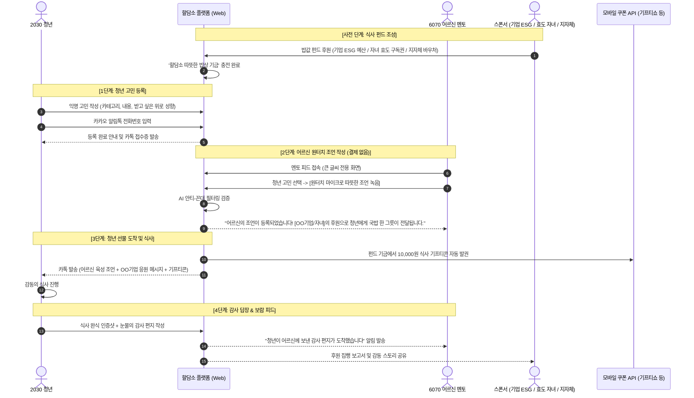

# [PRD] 할담소 (랜선 밥 사주는 어른) 제품 요구사항 정의서

| 항목 | 내용 |
| :--- | :--- |
| **문서 버전** | v1.2 (BM 피봇 및 시니어 0원 무과금 모델 재검토 반영) |
| **작성일** | 2026-11-04 |
| **문서 상태** | BM 재검토 중 (Pivot Review) |
| **대상 플랫폼** | 모바일 반응형 웹 (Mobile-First Web) |
| **주요 사용자** | 청년(2030 고민 작성자), 어르신(6070 명예 멘토), 후원 주체(기업/자녀/지자체) |

---

## 💡 BM 재검토 배경 및 핵심 방향 (Pivot Rationale)

> **"어르신에게 스마트폰으로 계좌이체나 카드 결제를 요구하는 것은 서비스 성립을 가로막는 치명적인 병목이다."**  
> 6070 시니어에게 인증서 갱신, 보안 키패드, 앱 전환, 복사/붙여넣기 등 모바일 금융 업무는 여전히 거대한 장벽입니다.  
> 따라서 **"어르신에게 돈을 받지 않고(0원), 어르신은 오직 '인생의 지혜'만 나누며 자존감을 얻는 구조"**로 BM을 전면 재검토합니다.  
> 청년의 밥값(10,000원)과 플랫폼 운영비는 **기업 ESG, 자녀(효도 선물), 지자체 바우처** 등 외부 스폰서십을 통해 조달합니다.

---

## 1. 제품 목적 및 핵심 가치 (Product Goal)
- **청년 (Youth)**: 비용 부담 제로(0원)로 인생 고민을 털어놓고, 따뜻한 인생 조언과 함께 **실제 식사 기프티콘(10,000원)**을 지원받아 위로와 물리적 에너지를 얻음.
- **어르신 (Senior)**: **비용 부담 제로(0원)**로 청년의 고민에 인생 조언을 건네며, **"사회적 존경, 인정, 살아있는 삶의 보람"**을 획득함. (결제 스트레스 완전 배제)
- **후원 스폰서 (기업/자녀/지자체)**: 청년 결식 예방 + 시니어 고립 해소라는 강력한 사회적 가치(ESG/효도/공공복지) 달성.
- **플랫폼 (Hal-Dam-So)**: 세대 상생 트래픽 창출 및 후원 매칭 수수료/캠페인 운영비 확보.

---

## 2. 유저 페르소나 및 핵심 문제

### 2.1 청년 페르소나 (김민수, 26세, 취업준비생)
- **Pain Point**: 서류 탈락 연속, 통장 잔고 바닥, 부모님과 친구들에게 털어놓지 못하는 불안감과 자책감.
- **Needs**: 평가나 훈계 없는 무조건적인 내 편, 그리고 오늘 저녁 배를 채워줄 따뜻한 국밥 한 그릇.

### 2.2 어르신 페르소나 (박덕배, 69세, 은퇴 공직자)
- **Pain Point**: 은퇴 후 하루 종일 찾는 사람이 없음. 사회에서 쓸모없는 늙은이가 된 것 같은 무력감. 폰뱅킹이나 모바일 결제는 복잡하고 무서워서 절대 못 함.
- **Needs**: 내 인생 경험이 젊은 세대에게 도움이 된다는 존재 가치, **"복잡한 결제나 송금 없이 버튼 하나로 쉽게 말로 전하는 조언"**.

### 2.3 후원자 페르소나 (신규 유입 주체)
- **3040 자녀**: 부모님의 우울감을 덜어드리고 자존감을 세워드리고 싶은 효도 니즈.
- **기업 ESG 담당자**: 진정성 있는 세대 상생 캠페인을 통해 브랜드 호감도를 높이고 싶은 니즈.

---

## 3. 핵심 유저 저니 및 플로우 (User Flow - 어르신 무과금형)

---

## 4. 기능 요구사항 명세 (Functional Specs)

### 4.1 청년 기능 (Youth Portal)
| ID | 기능명 | 설명 | 우선순위 |
| :--- | :--- | :--- | :---: |
| **FR-Y01** | **익명 고민 작성기** | - 제목(최대 40자), 본문(최대 1,000자) - 카테고리: 취업/진로, 연애/이별, 번아웃/우울, 인간관계 | **P0 (필수)** |
| **FR-Y02** | **카카오 알림톡 접수** | - 별도 가입 없이 휴대폰 번호 본인 인증 1회로 접수 완료 | **P0 (필수)** |
| **FR-Y03** | **선물 수신 뷰어** | - 어르신 육성 플레이어 + 10,000원 식사 기프티콘 바코드 | **P0 (필수)** |
| **FR-Y04** | **식사 인증 & 감사 편지** | - 완식 인증샷(최대 2장) + 어르신께 드리는 감사 손편지(50자 이상) | **P0 (필수)** |

---

### 4.2 어르신 기능 (Senior Mentor Portal - 100% 무과금)
| ID | 기능명 | 설명 | 우선순위 |
| :--- | :--- | :--- | :---: |
| **FR-S01** | **실버 친화 전용 UI** | - 기본 폰트 24pt 이상, 고대비 디자인, 초대형 터치 버튼 | **P0 (필수)** |
| **FR-S02** | **고민 피드 브라우징** | - 실시간 청년 고민 카드 열람 (음성 낭독 TTS 지원) - 미매칭 청년 우선 정렬 | **P0 (필수)** |
| **FR-S03** | **원터치 육성 조언 녹음** | - **[결제 과정 완전 제거]** - 마이크 버튼 1번 눌러 최대 3분 육성 녹음 후 즉시 전송 | **P0 (필수)** |
| **FR-S04** | **AI 안티-꼰대 필터** | - 상처 주는 표현 감지 시 따뜻한 어투로 실시간 순화 제안 | **P0 (필수)** |
| **FR-S05** | **보람 피드 (손주 소식)** | - 내가 조언해 준 청년들의 식사 인증샷 및 감사 편지 보관함 | **P0 (필수)** |

---

### 4.3 후원자 관리 기능 (Sponsor & Business Portal) - *BM 재검토 신규*
| ID | 기능명 | 설명 | 우선순위 |
| :--- | :--- | :--- | :---: |
| **FR-B01** | **B2B 기업 ESG 스폰서십** | - 기업 전용 브랜드 배너 ("배민/오뚜기와 함께하는 청년 밥상") - 후원 건수별 실시간 기금 차감 및 집행 대시보드 | **P1 (검토중)** |
| **FR-B02** | **자녀의 효도 선물 구독권** | - 3040 자녀가 부모님 명의로 월 29,900원(밥 사주기 2회권) 정기 결제 - 부모님 앱에 "아들/딸이 보낸 밥 사주기 선물권" 충전 표시 | **P1 (검토중)** |

---

## 5. 비즈니스 모델(BM) 피봇 대안 비교 및 재검토

| 비교 항목 | [모델 A] 기업 ESG 매칭 펀드 (B2B) | [모델 B] 자녀의 효도 선물 구독 (B2C) | [모델 C] 지자체 바우처 사업 (B2G) |
| :--- | :--- | :--- | :--- |
| **결제 주체** | **식품/금융 대기업, 배달 플랫폼** | **3040 자녀 (모바일 결제 숙련층)** | **지자체 청년청 / 보건복지부** |
| **어르신 부담** | **0원 (비용 부담 전혀 없음)** | **0원 (자녀가 사전 결제)** | **0원 (오히려 소정의 활동비 지급 가능)** |
| **핵심 가치** | 청년 결식 예방 + 세대화합 ESG 마케팅 | 혼자 계신 부모님의 우울감 해소 및 자존감 선물 | 고립 청년 조기 발굴 및 노인 사회참여 복지 |
| **수익 구조** | 후원 집행 수수료 (건당 3,000~5,000원) | 구독료 수수료 (월 29,900원 중 약 1만 원 마진) | 공공 프로젝트 용역 및 위탁 운영비 |
| **장점** | 초기 대규모 자금 및 공신력 확보 용이 | 결제력이 가장 높은 3040 타깃, 빠른 런칭 가능 | 공공 신뢰도 극대화, 장기적 제도권 안착 |
| **단점** | 기업 스폰서 영업에 1~2개월 소요 | 자녀 대상 마케팅 비용 소요 | 제안서 및 입찰 행정 절차 필요 |

> **💡 전략적 권장 방향**:  
> **초기 MVP(1단계)**는 **[모델 B: 자녀 효도 선물]** 또는 **[소액 매칭 펀드(창업팀 자체 시드 기금 50만 원)]**으로 어르신 0원 모델의 감동 스토리를 빠르게 검증하고,  
> 쌓인 바이럴 데이터를 기반으로 **2단계에서 [모델 A: 기업 ESG 후원]**을 대형 유치하는 투트랙 전략을 제안합니다.

---

## 6. 단계별 개발 마일스톤 (재조정)

- **Sprint 1 (1~2주 차)**:
  - 청년 익명 고민 작성기 및 알림톡 연동
  - 어르신 0원 원터치 음성 녹음기 프로토타입 구현 (결제창 제거)
- **Sprint 2 (3~4주 차)**:
  - 밥값 후원 펀드 풀(Pool) 자동 차감 시스템 구현
  - 기프티콘 자동 발권 API 및 AI 안티-꼰대 필터 연동
  - (옵션) 자녀용 효도 선물 결제 랜딩 페이지 제작
- **Sprint 3 (5주 차)**:
  - 청년 감사 손편지 갤러리 및 보람 피드 뷰어
  - 초기 시니어 10명 + 청년 20명 대상 무과금 클로즈드 베타 테스트(CBT)
- **Sprint 4 (6주 차)**:
  - 감동 스토리 숏폼/카드뉴스 제작 및 SNS 배포
  - B2B 기업 ESG 제안서 발송 및 공식 런칭
