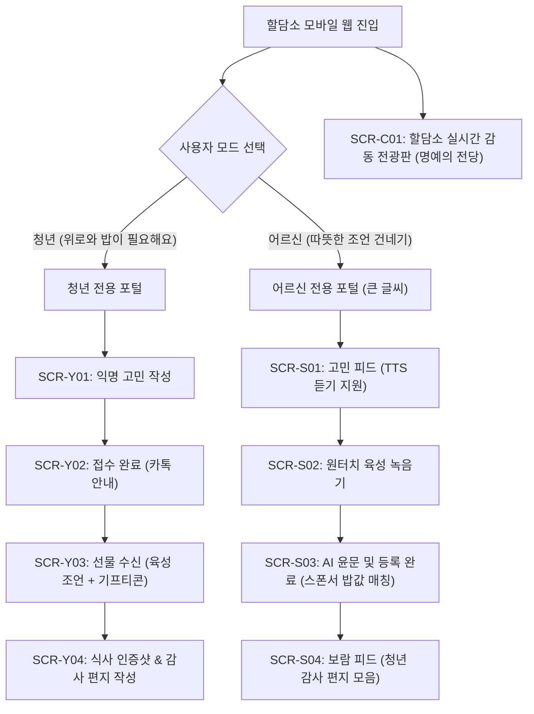

# [화면설계서] 할담소 (랜선 밥 사주는 어른) UI/UX 와이어프레임 & 화면 명세

| 항목 | 내용 |
| :--- | :--- |
| **문서 버전** | v1.0 |
| **작성일** | 2026-11-04 |
| **문서 상태** | 초안 완료 (Draft) |
| **대상 플랫폼** | 모바일 반응형 웹 (Mobile-First Web) |
| **주요 사용자** | 2030 청년 (고민 작성자), 6070 시니어 (명예 멘토) |

---

## 1. 정보 구조도 (IA: Information Architecture)



---

## 2. 디자인 시스템 및 시니어 UI/UX 원칙

### 2.1 시니어 친화 UI 원칙 (Silver-First Guidelines)
- **최소 폰트 크기**: 본문 24pt, 버튼 26pt, 제목 32pt 이상 (시스템 기본 글자 크기의 150% 수준)
- **터치 영역 극대화**: 모든 클릭 가능 버튼의 높이는 최소 **68px** 이상 확보 (손떨림 터치 미스 방지)
- **고대비 명도비율**: 텍스트와 배경의 명도 대비 7:1 이상 유지 (흐릿한 회색 텍스트 배제, 진한 밤색/검정 텍스트)
- **제로 제스처**: 스와이프, 핀치투줌, 드래그앤드롭 등 복잡한 제스처 배제, 오직 **'원터치 탭(Tap)'**으로만 조작
- **시각적+청각적 이중 피드백**: 버튼 누를 때 진동 햅틱, 글씨 읽어주는 TTS(음성 낭독), 녹음 시 명확한 붉은 점등

### 2.2 청년 친화 UI 원칙 (Youth Guidelines)
- **따뜻한 감성 톤앤매너**: 새벽 편지 감성의 딥 네이비(밤하늘) + 따스한 귤빛 오렌지 포인트 컬러
- **심리적 안정감**: 익명성 보장 뱃지, 불필요한 회원가입 절차 없는 미니멀 폼

---

## 3. 화면별 상세 와이어프레임 및 기능 명세

---

### [SCR-Y01] 청년 익명 고민 작성 화면

```text
┌──────────────────────────────────────────┐
│ [할담소] 🍚 든든한 밥과 위로가 필요할 때  │
├──────────────────────────────────────────┤
│                                          │
│  "힘든 오늘, 밥은 챙겨 먹었니?"          │
│  인생 선배 할머니, 할아버지가             │
│  따뜻한 조언과 든든한 국밥을 보냅니다.    │
│                                          │
│  [1] 어떤 고민인가요? (카테고리 선택)    │
│  ┌───────┐ ┌───────┐ ┌───────┐ ┌───────┐ │
│  │ 취업/진로│ │ 연애/이별│ │ 번아웃 │ │ 가족/관계││
│  └───────┘ └───────┘ └───────┘ └───────┘ │
│                                          │
│  [2] 원하는 어른의 성향을 골라주세요     │
│  ○ 순자 할머니 (츤데레 팩폭 & 용기)       │
│  ● 옥분 할머니 (따뜻한 위로와 토닥임)    │
│  ○ 덕배 할아버지 (산전수전 돌파의 지혜)   │
│  ○ 종석 할아버지 (다정한 낭만 조언)       │
│                                          │
│  [3] 당신의 고민을 털어놓아 보세요       │
│  ┌────────────────────────────────────┐  │
│  │ 제목: 서류 30번째 탈락, 너무 지쳐요 │  │
│  ├────────────────────────────────────┤  │
│  │ 부모님 볼 면목도 없고, 오늘 하루종 │  │
│  │ 일 라면만 먹었습니다... (최대 1000자)│  │
│  └────────────────────────────────────┘  │
│                                          │
│  [4] 답변과 밥값 쿠폰을 받을 카카오톡 번호│
│  ┌────────────────────┐ ┌────────────┐  │
│  │ 010 - 1234 - 5678  │ │ 인증번호 받기│ │
│  └────────────────────┘ └────────────┘  │
│  * 개인정보는 상담 완료 후 암호화 파기됩니다. │
│                                          │
│  ┌────────────────────────────────────┐  │
│  │   [ 밥 한 끼와 말씀 신청하기 (무료) ]   │  │
│  └────────────────────────────────────┘  │
└──────────────────────────────────────────┘
```

* **인터랙션 명세**:
  - 카테고리 및 멘토 성향은 단일 선택(라디오 칩).
  - 휴대폰 번호는 카카오 알림톡 발송용이며, SMS 6자리 인증 후 즉시 접수 가능.
  - 신청 완료 시 `SCR-Y02`로 이동하고 카톡으로 "상담 접수증" 발송.

---

### [SCR-S01] 어르신 전용 큰 글씨 피드 화면 (Senior Feed)

```text
┌──────────────────────────────────────────┐
│  👵 할담소: 청년 밥 사주는 사랑방        │
│  [내 손주 소식함 (3)]    [큰 글씨 모드 ON]│
├──────────────────────────────────────────┤
│                                          │
│  어르신, 반갑습니다! 🌸                   │
│  오늘도 따뜻한 밥 한 끼와 지혜를 기다리는 │
│  청년들이 있습니다.                      │
│                                          │
│ ┌──────────────────────────────────────┐ │
│ │ 🌟 아직 밥을 못 먹은 청년 (취준생)    │ │
│ │                                      │ │
│ │ "서류 30번째 탈락, 너무 지쳐요..."   │ │
│ │ 나이: 26세 청년 / 원하는 멘토: 옥분 할머니│
│ │                                      │ │
│ │ "부모님 볼 면목도 없고, 오늘 라면만  │ │
│ │  먹었습니다. 다시 시작할 힘이 없네요"│ │
│ │                                      │ │
│ │ ┌──────────────────────────────────┐ │ │
│ │ │ 🔊 청년의 글 소리내어 듣기 (TTS)  │ │ │
│ │ └──────────────────────────────────┘ │ │
│ │                                      │ │
│ │ ┌──────────────────────────────────┐ │ │
│ │ │ 🎙️ [이 청년에게 따뜻한 말씀 건네기] │ │ │
│ │ └──────────────────────────────────┘ │ │
│ └──────────────────────────────────────┘ │
│                                          │
│ ┌──────────────────────────────────────┐ │
│ │ 🌟 아직 밥을 못 먹은 청년 (사회초년생) │ │
│ │ "직장에서 혼자만 겉도는 것 같아요..." │ │
│ │ ...                                  │ │
│ └──────────────────────────────────────┘ │
└──────────────────────────────────────────┘
```

* **인터랙션 명세**:
  - 모든 텍스트 기본 24pt 이상 적용.
  - **`[🔊 소리내어 듣기]`**: 작은 글씨 읽기 힘드신 분을 위해 음성 합성(TTS)으로 고민 글을 정갈한 목소리로 읽어줌.
  - **`[🎙️ 따뜻한 말씀 건네기]`** 클릭 시 다른 사람이 가로채지 못하게 해당 글 30분간 선점 락(Lock) 후 `SCR-S02`로 진입.

---

### [SCR-S02] 어르신 원터치 육성 녹음기 화면 (Senior Voice Recorder)

```text
┌──────────────────────────────────────────┐
│  < 뒤로가기       청년에게 한마디 건네기  │
├──────────────────────────────────────────┤
│                                          │
│  고민 청년: 26세 취업준비생 김민수        │
│  "서류 30번째 탈락하고 라면만 먹었어요"  │
│                                          │
│  ──────────────────────────────────────  │
│                                          │
│      마이크 버튼을 꾹 누르고             │
│      손주에게 하듯 편하게 말씀해 주세요. │
│                                          │
│                   ╭──────╮               │
│                   │ 🎙️  │  (지름 120px) │
│                   ╰──────╯               │
│                                          │
│           [ 🔴 말씀 녹음 시작 ]          │
│                                          │
│  * 녹음 시간: 최대 3분                   │
│  * 말씀이 끝나면 아래 완료를 눌러주세요. │
│                                          │
│  ──────────────────────────────────────  │
│  (녹음 진행 중 화면 상태 예시)           │
│  ● 녹음 중... (01:24 / 03:00)            │
│  [||| ||||||| ||||| |||||||||||] 음성 파형 │
│                                          │
│  ┌─────────────────┐  ┌────────────────┐ │
│  │ 🔄 처음부터 다시 │  │ ✅ 말씀 다했어요│ │
│  └─────────────────┘  └────────────────┘ │
└──────────────────────────────────────────┘
```

* **인터랙션 명세**:
  - 화면 중앙에 손바닥만 한 **초대형 원형 마이크 버튼** 제공.
  - 마이크를 누르면 부드러운 진동과 함께 테두리가 붉은색으로 깜빡이며 녹음 시작.
  - 실시간 음성 파형을 보여주어 "내 목소리가 제대로 들어가고 있구나"를 직관적으로 인지.
  - `[✅ 말씀 다했어요]` 클릭 시 배경 노이즈 자동 제거 후 `SCR-S03` 등록 팝업 호출.

---

### [SCR-S03] AI 순화 검증 및 매칭 완료 팝업 (Sponsor Matched)

```text
┌──────────────────────────────────────────┐
│             어르신, 참 잘하셨습니다! 🌸    │
├──────────────────────────────────────────┤
│                                          │
│  남겨주신 따뜻한 한마디가                │
│  민수 청년에게 큰 용기가 될 것입니다.     │
│                                          │
│  ┌────────────────────────────────────┐  │
│  │ 🎧 내가 녹음한 말씀 다시 들어보기   │  │
│  │ ▶ 01:24 / "아가야, 실패가 아니라..."│  │
│  └────────────────────────────────────┘  │
│                                          │
│  [🎁 후원 파트너 안내]                   │
│  어르신의 소중한 지혜에 감동하여,         │
│  "배달의민족 (우아한형제들)"에서          │
│  청년에게 10,000원 국밥 식사권을 쏩니다! │
│                                          │
│  * 어르신 비용 부담: 0원 (전액 무료)      │
│                                          │
│  ┌────────────────────────────────────┐  │
│  │     [ 민수 청년에게 선물 보내기 ]     │  │
│  └────────────────────────────────────┘  │
└──────────────────────────────────────────┘
```

* **인터랙션 명세**:
  - AI 안티-꼰대 필터가 실시간 검증 완료 후 정상 등록 승인.
  - 어르신에게 **"어르신의 말씀 덕분에 기업 후원으로 청년에게 국밥이 전달된다"**는 자긍심 부여.
  - 버튼 클릭 시 즉시 쿠폰 API가 호출되어 청년에게 카톡 발송.

---

### [SCR-Y03] 청년 선물 수신 뷰어 (육성 오디오 & 기프티콘)

```text
┌──────────────────────────────────────────┐
│  💌 옥분 할머니의 따뜻한 밥과 말씀 도착   │
├──────────────────────────────────────────┤
│                                          │
│   "아가야, 실패가 아니라 더 좋은 길로    │
│    가기 위한 우회로일 뿐이란다."         │
│                                          │
│  ┌────────────────────────────────────┐  │
│  │  📀 옥분 할머니의 육성 오디오 카드 │  │
│  │                                    │  │
│  │   [ ▶ 재생 (01:24) ]               │  │
│  │   잔잔한 피아노 배경음악과 함께    │  │
│  │   할머니의 생생한 목소리가 재생됨  │  │
│  └────────────────────────────────────┘  │
│                                          │
│  🍲 옥분 할머니 & 배민이 쏜 따뜻한 국밥  │
│  ┌────────────────────────────────────┐  │
│  │        [ 모바일 식사 기프티콘 ]    │  │
│  │        ||||||||||||||||||||||      │  │
│  │            1234 - 5678 - 9012      │  │
│  │        (10,000원권 / 전국 사용)    │  │
│  └────────────────────────────────────┘  │
│                                          │
│  ┌────────────────────────────────────┐  │
│  │  [ 🍚 밥 든든히 먹고 감사 답장 쓰기 ] │  │
│  └────────────────────────────────────┘  │
└──────────────────────────────────────────┘
```

* **인터랙션 명세**:
  - 오디오 플레이어 클릭 시 배경음악(Lofi 힐링 피아노)과 어르신의 음성이 자동 믹싱되어 영화 같은 감동 선사.
  - 기프티콘 바코드는 이미지 저장 및 배달의민족/식당 현장 결제 지원.

---

### [SCR-Y04] 식사 완식 인증샷 & 손편지 작성 화면

```text
┌──────────────────────────────────────────┐
│  < 뒤로가기         할머니께 드리는 답장 │
├──────────────────────────────────────────┤
│                                          │
│  할머니 덕분에 따뜻한 한 끼를 먹었습니다. │
│  빈 그릇 사진과 진심 어린 편지를 남기면  │
│  할머니의 [손주 소식함]으로 전달됩니다.  │
│                                          │
│  [1] 든든하게 비운 완식 인증샷 (필수)    │
│  ┌────────────────────────────────────┐  │
│  │  📷 [뚝배기 비운 사진 올리기 +]   │  │
│  │  (완식 사진 미리보기 표출 영역)    │  │
│  └────────────────────────────────────┘  │
│                                          │
│  [2] 할머니께 전하는 손편지 (최소 50자)  │
│  ┌────────────────────────────────────┐  │
│  │ 할머니, 보내주신 국밥 한 그릇 눈물 │  │
│  │ 흘리며 다 먹었습니다. 할머니 말씀대│  │
│  │ 로 툭툭 털고 내일부터 다시 자소서  │  │
│  │ 쓰겠습니다. 꼭 취업해서 할머니처럼  │  │
│  │ 멋진 어른이 되겠습니다. 감사합니다!│  │
│  └────────────────────────────────────┘  │
│                                          │
│  [✓] 할담소 명예의 전당 전광판에 공개 동의│
│                                          │
│  ┌────────────────────────────────────┐  │
│  │        [ 할머니께 감사 편지 보내기 ] │  │
│  └────────────────────────────────────┘  │
└──────────────────────────────────────────┘
```

---

### [SCR-S04] 어르신 보람 피드 (내 손주 소식함)

```text
┌──────────────────────────────────────────┐
│  👵 내 손주 소식함 (내가 살린 청년들)    │
├──────────────────────────────────────────┤
│                                          │
│ ┌──────────────────────────────────────┐ │
│ │ 💌 김민수 청년 (26세 취준생)         │ │
│ │ 2026.11.04 18:30 답장 도착           │ │
│ │                                      │ │
│ │ ┌──────────────────┐                 │ │
│ │ │ [깨끗이 비운     │ "할머니 말씀대로 │ │
│ │ │  국밥 뚝배기 사진│  눈물 닦고 다시 │ │
│ │ │  인증샷 표출]    │  도전할게요..." │ │
│ │ └──────────────────┘                 │ │
│ │                                      │ │
│ │ [ 💌 손편지 전체 크게 읽기 ]         │ │
│ └──────────────────────────────────────┘ │
│                                          │
│ ┌──────────────────────────────────────┐ │
│ │ 💌 이서연 청년 (24세 대학생)         │ │
│ │ "덕배 할아버지 덕분에 힘냈어요!"     │ │
│ └──────────────────────────────────────┘ │
└──────────────────────────────────────────┘
```

---

## 4. 모바일 반응형 Breakpoint 및 인터랙션 정책

- **Mobile First**: 스마트폰 세로 모드(360px ~ 430px)를 기준 해상도로 최우선 최적화.
- **Senior Viewport Override**:
  - 어르신 뷰포트에서는 화면 핀치 줌을 허용하거나 브라우저 기본 배율 120% 확대 지원.
  - 하단 네비게이션 바(GNB) 대신 **상단에 큼직한 '홈으로 / 내 손주 소식함' 단 2개 탭**만 노출.
- **네트워크 오프라인 대비**:
  - 음성 녹음 중 통신이 끊겨도 음성 데이터(Blob)를 IndexedDB/LocalStorage에 임시 보관하여 재접속 시 전송 재시도.
